<div align="center">

<p align="center">
  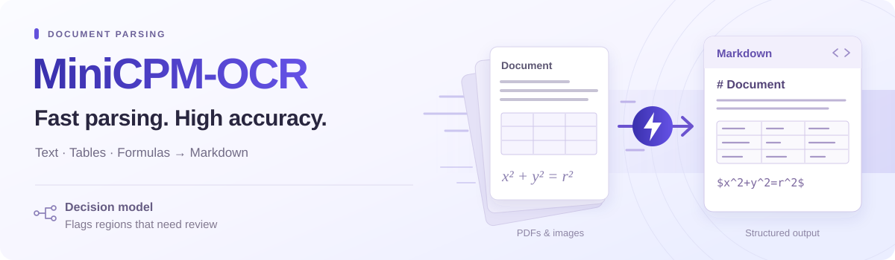
</p>

<p align="center">
  <a href="https://github.com/OpenBMB/MiniCPM">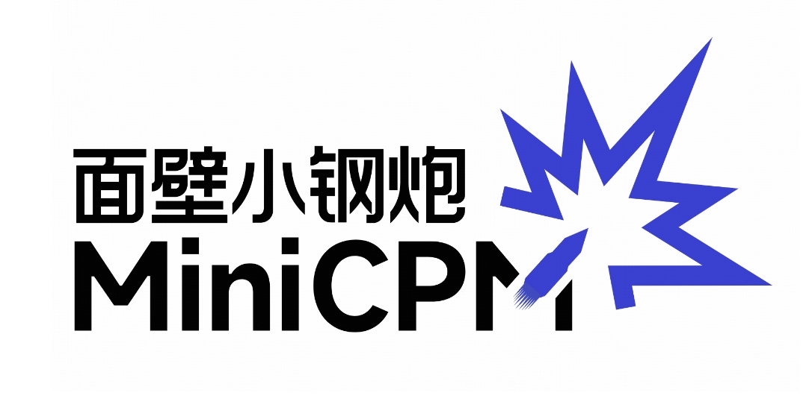</a>
</p>

<p align="center">
  <a href="./docs/minicpm_ocr_1dot0_zh.md"><strong>MiniCPM-OCR 1.0 模型指南</strong></a>&ensp;<a href="https://huggingface.co/openbmb/MiniCPM-OCR-1.0" title="Hugging Face"></a>&ensp;<a href="https://modelscope.cn/models/OpenBMB/MiniCPM-OCR-1.0" title="ModelScope"></a>
  &emsp;
  <a href="./docs/minicpm_ocr_jev_zh.md"><strong>MiniCPM-OCR Jev 模型指南</strong></a>&ensp;<a href="https://huggingface.co/openbmb/MiniCPM-OCR-Jev" title="Hugging Face"></a>&ensp;<a href="https://modelscope.cn/models/OpenBMB/MiniCPM-OCR-Jev" title="ModelScope"></a>
</p>

<p align="center">
  体验平台（<a href="https://platform.modelbest.cn/console/playground/document-parse">国内</a> / <a href="https://platform.modelbest.ai/console/playground/document-parse">海外</a>）
  &nbsp;·&nbsp;
  <a href="#quick-start">开始使用</a> &nbsp;·&nbsp;
  <a href="#model-weights">模型权重</a> &nbsp;·&nbsp;
  <a href="https://platform.modelbest.cn/console/docs/api/document-parse">免费 API</a> &nbsp;·&nbsp;
  <a href="#skill">Skill</a> &nbsp;·&nbsp;
  <a href="./docs/minicpm_ocr_tutorial.md">本地部署</a>
  &nbsp;|&nbsp; <a href="./README.md">English</a>
  <br>
  加入社区：
  <a href="https://applink.feishu.cn/client/chat/chatter/add_by_link?link_token=c35j072a-9abe-4ba6-ba1d-3ab340f9ba8c">飞书</a> &nbsp;·&nbsp;
  <a href="https://discord.gg/JE8KQqtdn">Discord</a>
</p>

</div>

<a id="overview"></a>

**MiniCPM-OCR** 是面向高效文档解析和文字识别的系列模型。**MiniCPM-OCR 1.0** 支持中英文档与 PDF 解析，在扫描、拍照、弯曲和翻拍等复杂场景下兼顾解析质量与处理效率。**MiniCPM-OCR Jev** 对 OCR 解析结果进行区域级质量判断，识别有问题与无问题的区域，可搭配不同解析模型，帮助用户定位需要复核的内容。

## 📢 最新动态

- **[2026.11.05]** MiniCPM-OCR 1.0 官方 [Docker 镜像](https://hub.docker.com/repository/docker/openbmbofficial/minicpm-ocr/general) 已发布，内置模型权重、SDK 和 vLLM，支持图片与 PDF 的端到端文档解析。部署方式见 [Docker 部署](#docker-deployment)。
- 🔥🔥🔥 **[2026.11.02] MiniCPM-OCR 1.0 现已支持 iOS 端侧运行！** 文档解析全程在设备本地完成，支持离线使用。[立即体验](https://github.com/OpenBMB/MiniCPM-OCR/blob/main/README_zh.md#mobile-demo)。
- **[2026.11.09]** [pip SDK 1.0.5](https://pypi.org/project/minicpm-ocr/1.0.5/) 发布：支持一次解析多个文件，每个文件各得一份结果。`--split-images` 让每张单图各自成一份文档。
- **[2026.11.02]** [pip SDK 1.0.4](https://pypi.org/project/minicpm-ocr/1.0.4/) 发布：JSON 输出格式与在线文档解析 API 保持一致，默认自动校正页面方向，并支持 GIF 图片输入。
- **[2026.10.30]** Web Demo 已开源，支持自行部署和中英文界面切换，详见 [Web Demo 部署教程](https://github.com/OpenBMB/MiniCPM-OCR/blob/main/docs/webdemo_deploy_zh.md)。
- **[2026.10.29]** [SDK 1.0.3](https://pypi.org/project/minicpm-ocr/1.0.3/) 发布：Markdown 输出保留图片区域的识别文字，并附上对应裁图的链接；[Skill](https://github.com/OpenBMB/MiniCPM-OCR/blob/main/README_zh.md#skill) 新增 Ollama 部署指南。
- 🚀🚀🚀 **[2026.10.27] MiniCPM-OCR 1.0 与 MiniCPM-OCR Jev 正式发布并开源！** 同步提供[模型权重](https://github.com/OpenBMB/MiniCPM-OCR/blob/main/README_zh.md#model-weights)、[pip SDK](https://pypi.org/project/minicpm-ocr/)、[Skill](https://github.com/OpenBMB/MiniCPM-OCR/blob/main/README_zh.md#skill) 和[免费 API](https://github.com/OpenBMB/MiniCPM-OCR/blob/main/README_zh.md#api)。

## MiniCPM-OCR 1.0

**MiniCPM-OCR 1.0** (1.3B) 是 [MiniCPM-V/o](https://github.com/openbmb/MiniCPM-V) 家族首个 OCR 专用模型，面向以文字为中心的文档理解，覆盖文本、表格、公式、图表与印章识别和结构化信息抽取。主要特点包括：

- 🏆 **SOTA 的文档解析能力**：MiniCPM-OCR 1.0 在真实场景文档解析评测 **Real5-OmniDocBench 上取得 93.68 的 SOTA 成绩**，并在 OmniDocBench v1.6、Wild-OmniDocBench 和 olmOCR-Bench 等评测中展现领先的解析能力。模型支持中英双语文档与 PDF 解析，兼顾标准文档和复杂采集条件，在扫描、弯曲、拍照、倾斜及翻拍等场景下保持稳定表现。
- ⚡ **高效推理。** 基于 DSpark 解码加速（[**DSpark-BF16**](https://huggingface.co/openbmb/MiniCPM-OCR-1.0-DSpark)、[**DSpark-GGUF**](https://huggingface.co/openbmb/MiniCPM-OCR-1.0-DSpark-gguf)），MiniCPM-OCR 1.0 的**端到端处理效率提升 55%**。其处理吞吐量约为 PaddleOCR-VL-1.6 的 **1.49 倍**、MinerU2.5 Pro 的 **3.62 倍**，降低大规模文档解析的时间开销。
- 🔍 **通用识别与信息抽取**：MiniCPM-OCR 1.0 在 **OCRBench v2 上取得 54.7 的 SOTA** 成绩，具备扎实的通用 OCR 能力；**同时支持关键信息抽取（KIE）**，可根据业务需求提取文档中的关键内容，支持后续信息整理与自动化处理。
- 🛠️ **部署与开发友好**：MiniCPM-OCR 1.0 首日**适配 vLLM、SGLang、llama.cpp 和 Ollama**，同步提供多芯片适配与多种量化版本。模型**支持二次微调**，提供 **[pip SDK](https://pypi.org/project/minicpm-ocr/)** 和 **[功能完备的 API](#api)**，方便应用集成与定制开发，也可 **[通过 SKILL.md 快速上手](#skill)**；同时提供在线体验平台（[国内](https://platform.modelbest.cn/console/playground/document-parse) / [海外](https://platform.modelbest.ai/console/playground/document-parse)），方便用户查看解析效果。

### SOTA 表现，更高吞吐

在图示的开源 OCR 模型对比中，MiniCPM-OCR 1.0 的解析吞吐量达到 1.2 pages/s，在 OmniDocBench v1.6、Real5-OmniDocBench、Wild-OmniDocBench 和 olmOCR-Bench 四项文档解析基准上取得最佳综合表现。

<p align="center"><a href="./assets/minicpm-ocr/efficiency-performance-zh.png">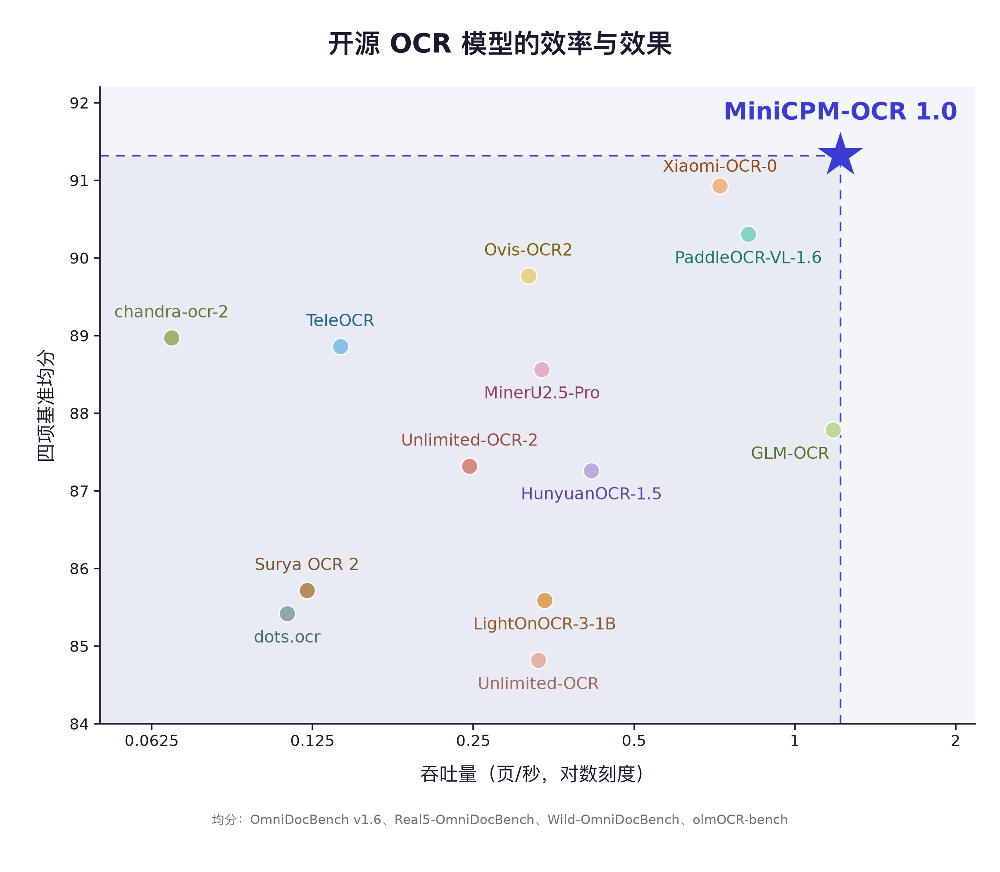</a></p>

<sub>测试设置与复现说明见 [复现文档](./docs/benchmark_reproduction_zh.md)；各模型的吞吐数值见 [模型指南的吞吐评测](./docs/minicpm_ocr_1dot0_zh.md#吞吐)。</sub>

<a id="ocr-benchmark"></a>

### 各基准效果对比

<p align="center"><a href="./assets/minicpm-ocr/benchmark-radar.png">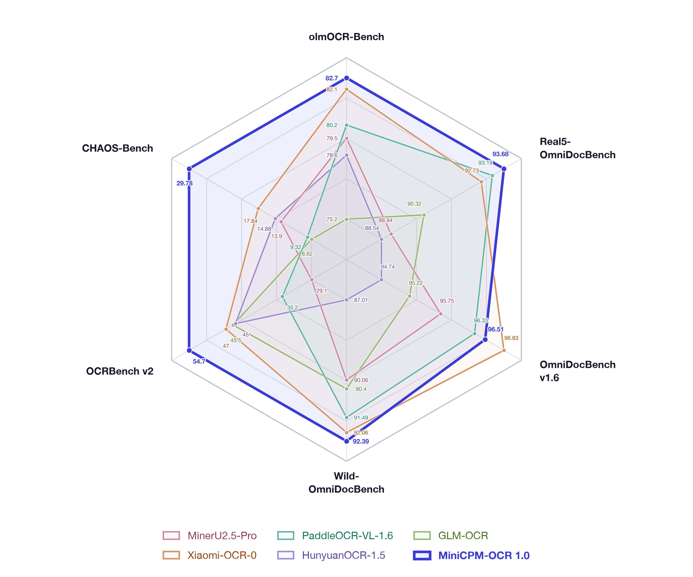</a></p>

<details>
<summary>点击查看 MiniCPM-OCR 1.0 完整评测结果</summary>

<p align="center"><a href="./assets/minicpm-ocr/ocr-benchmarks.png">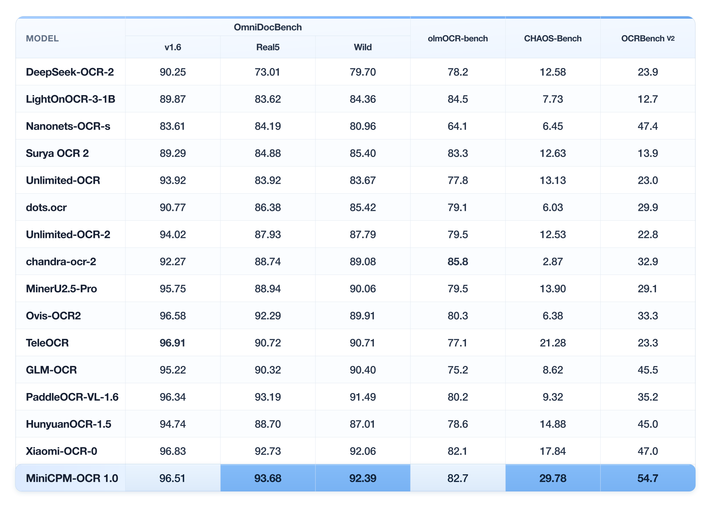</a></p>

</details>

各基准柱状图与吞吐明细见 [MiniCPM-OCR 1.0 模型指南](./docs/minicpm_ocr_1dot0_zh.md#评测)。

### 典型示例

<p align="center"><a href="https://youtu.be/lJOzZytWoK8">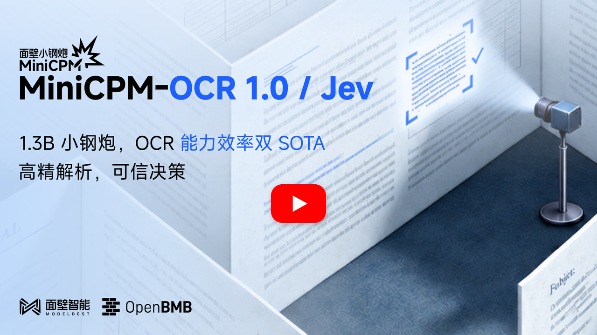</a></p>

从左至右依次为原始文档、检测到的版面和渲染后的 Markdown。

#### 中文文档

<p align="center"><a href="./assets/minicpm-ocr/minicpm-chinese-examples-3-column.gif">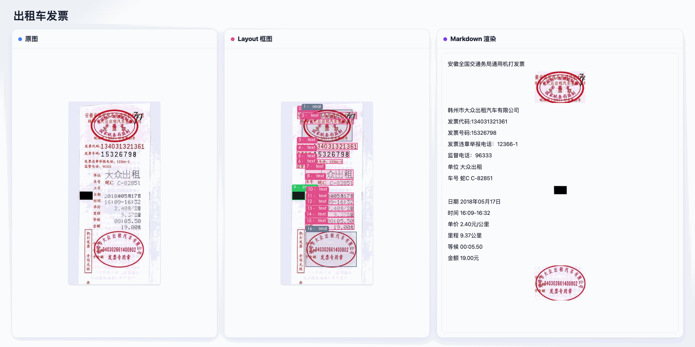</a></p>

<details>
<summary>更多中文案例</summary>

原图与解析结果对照。

<p align="center"><a href="./assets/minicpm-ocr/minicpm-ocr-chinese-cases.png"></a></p>

</details>

#### 英文文档

<p align="center"><a href="./assets/minicpm-ocr/minicpm-english-examples-3-column.gif">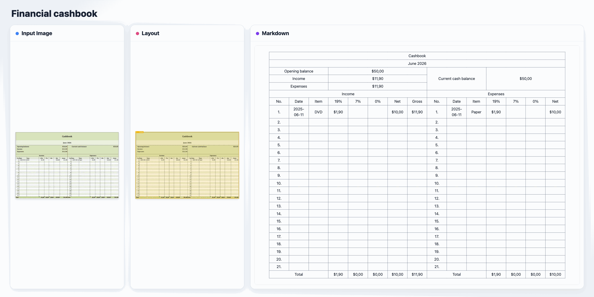</a></p>

<details>
<summary>更多英文案例</summary>

原图与解析结果对照。

<p align="center"><a href="./assets/minicpm-ocr/minicpm-ocr-english-cases.png"></a></p>

</details>

## MiniCPM-OCR Jev

**MiniCPM-OCR Jev** 是面向文本、公式和表格的 **OCR 正确性决策模型**。输入图像及对应的 OCR 结果，即可获得 **0–1 的质量评分**，用于筛选可靠结果、定位待复核内容。

- 🛡️ **以小胜大**：仅 2B 参数，在 [JevOCRBench](https://huggingface.co/datasets/openbmb/JevOCRBench) 上决策精度 AUROC（×100）达到 93.6，**反超 JEV-35B-A3B（90.1）**，接近 Qwen3.5-397B-A17B（93.8）。
- 🧩 **稳定泛化**：在 MiniCPM-OCR 1.0、GLM-OCR、PaddleOCR-VL-1.6 和 Xiaomi-OCR-0 的解析结果上，AUROC（×100）为 **91.9–93.4**。

<a id="jev-benchmark"></a>

### 评测表现

下表展示 JevOCRBench 的整体与分类型 AUROC（×100），数值越高表示区分正确和错误解析结果的能力越强。

<p align="center"><a href="./assets/minicpm-ocr/jev-benchmark-score-table.png">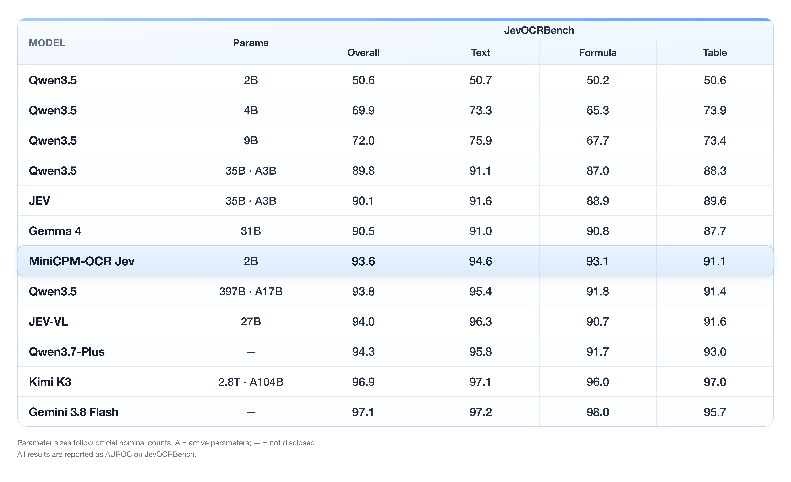</a></p>

<a id="判别力跨ocr模型泛化"></a>
<a id="使用场景"></a>
<a id="用法一块级直通省掉大部分人工核验"></a>
<a id="用法二多专家聚合扩展-ocr-的能力边界"></a>

### 免检准确率

三类文档在不同免检比例下的准确率。

<p align="center"><a href="./assets/minicpm-ocr/review-free-zh.png">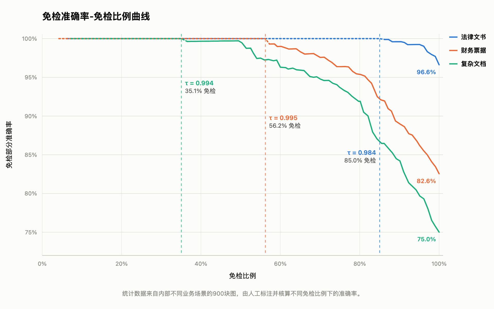</a></p>

具体阈值的设定建议先在真实场景下进行小批量的验证再确定。

### 判别示例

文本、公式和表格识别结果的 Jev 评分。

<p align="center"><a href="./assets/minicpm-ocr/jev-case-zh.png">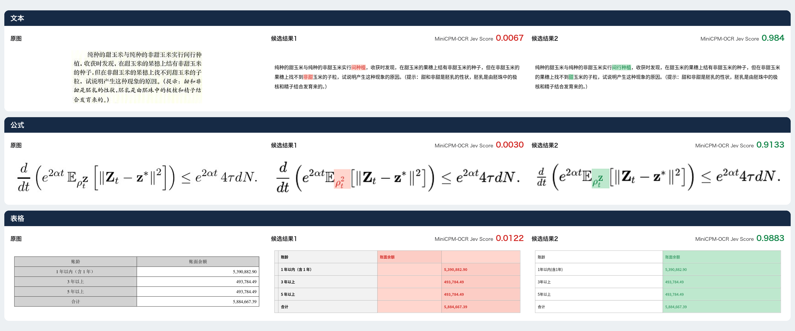</a></p>

使用方法、技术规格、评测结果和效率结果详见 [MiniCPM-OCR Jev 模型指南](./docs/minicpm_ocr_jev_zh.md)。

<a id="quick-start"></a>

## MiniCPM-OCR 使用

选择适合你的 MiniCPM-OCR 1.0 和 MiniCPM-OCR Jev 接入方式：

### 文档解析的两阶段流程

整页文档解析由 [`minicpm-ocr` SDK](https://pypi.org/project/minicpm-ocr/) 统一编排，采用**两阶段流水线**：两个阶段使用不同的模型，分别运行在相互独立的环境中，也可以部署在不同的机器上：

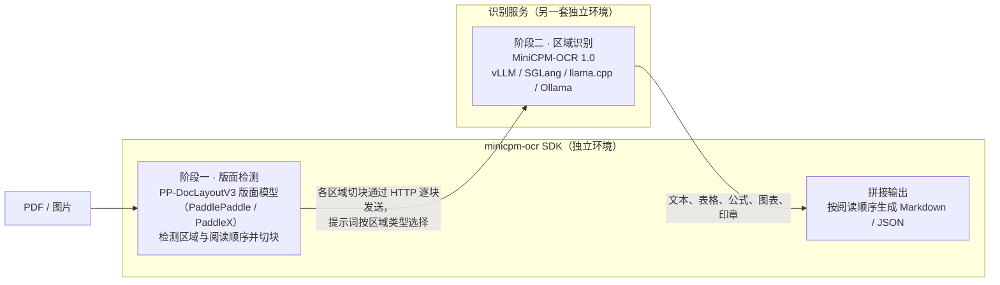

- **阶段一 · 版面检测（SDK 本地运行）**：PP-DocLayoutV3 版面模型检测文档区域（文本、表格、公式、图表、印章等）并分析阅读顺序，SDK 按区域切块。版面检测在 SDK 环境中本地完成，依赖 PaddlePaddle / PaddleX。
- **阶段二 · 区域识别（推理服务）**：SDK 通过 HTTP 将每个切块发送给 MiniCPM-OCR 1.0 推理服务（由 vLLM、SGLang、llama.cpp 或 Ollama 部署），提示词按区域类型选择（`Text Recognition:`、`Table Recognition:`、`Formula Recognition:` 等），识别结果再按阅读顺序拼接为最终的 Markdown / JSON。

因此，完整的本地部署需要同时准备**两套环境**：SDK 环境（pip 包 `minicpm-ocr`，并额外安装 PaddlePaddle / PaddleX 以运行版面模型）和所选推理后端的服务环境。[Skill](#skill) 给出了从后端选择、环境安装、模型下载到验证的完整步骤；手动部署的相同步骤见 [SDK 使用教程](./docs/minicpm_ocr_tutorial.md)。各区域提示词与各阶段的详细说明见[文档解析流程](./docs/minicpm_ocr_1dot0_zh.md#文档解析流程)。

<a id="使用-agent-skill-部署推荐"></a>
<a id="skill"></a>

### Skill

让编码 Agent 按 MiniCPM-OCR 1.0 [skill](./docs/SKILL.md) 完成环境配置、模型下载和首次文档解析。将以下指令发送给 Agent：

```text
Read and execute https://github.com/OpenBMB/MiniCPM-OCR/blob/main/docs/SKILL.md
```

让编码 Agent 按 MiniCPM-OCR Jev [skill](./docs/SKILL_jev.md) 完成打分服务的本地部署、启动和验证：Docker 镜像与 SDK 两条路径都覆盖，SDK 支持 vLLM、SGLang、llama.cpp 和 Ollama 四个推理后端。将以下指令发送给 Agent：

```text
Read and execute https://github.com/OpenBMB/MiniCPM-OCR/blob/main/docs/SKILL_jev.md
```

已克隆本仓库时，也可直接使用 `./docs/SKILL.md` 和 `./docs/SKILL_jev.md`。

<a id="docker-deployment"></a>

### Docker 部署

使用 MiniCPM-OCR 1.0 官方 [Docker 镜像](https://hub.docker.com/repository/docker/openbmbofficial/minicpm-ocr/general) 快速部署。镜像内置模型权重、SDK、vLLM 和文档解析后端；Docker Hub 页面提供 OCR 模型接口与端到端文档解析 API 的启动步骤，支持将图片和 PDF 解析为 Markdown / JSON。

需要 Linux x86-64、NVIDIA GPU、兼容 CUDA 12.9 的驱动，以及已配置 NVIDIA Container Toolkit 的 Docker。请按镜像页面中的说明选择并启动所需服务。

<a id="api"></a>

### 免费API

通过免费API接入 MiniCPM-OCR 1.0 的识别能力和 MiniCPM-OCR Jev 的质量判别能力。

[MiniCPM-OCR 1.0 API 文档](https://platform.modelbest.cn/console/docs/api/document-parse) &emsp;·&emsp; [MiniCPM-OCR Jev API 文档](https://platform.modelbest.cn/console/docs/api/ocr-jev)

<a id="mobile-demo"></a>

### MiniCPM-V Demo — iOS、Android 与 HarmonyOS

MiniCPM-OCR 1.0 支持完全在设备本地完成文档解析，离线也能使用。该文档识别功能目前仅在 iOS 上提供。

[端侧 Demo 教程](https://github.com/OpenBMB/MiniCPM-V-Apps/blob/main/README_zh.md)

<a id="手动部署"></a>

<a id="local-deployment"></a>

### 本地部署

在自己的设备上运行模型：MiniCPM-OCR 1.0 将 PDF 和图片解析为 Markdown 或 JSON，MiniCPM-OCR Jev 对解析结果评分。

[MiniCPM-OCR 1.0 部署教程](./docs/minicpm_ocr_tutorial.md) · [MiniCPM-OCR Jev 部署教程](./docs/minicpm_ocr_jev_tutorial_zh.md) · [Web Demo 部署教程](./docs/webdemo_deploy_zh.md)

<a id="fine-tuning"></a>

### 模型微调

| 模型 | 微调教程 |
| :--- | :--- |
| MiniCPM-OCR 1.0 | [LLaMA-Factory](./docs/llamafactory_minicpm_ocr_french.md) · [Swift](./docs/swift_minicpm_ocr_french.md) |
| MiniCPM-OCR Jev | [Swift](./docs/finetune_jev_zh.md) |

<a id="resources"></a>
<a id="model-weights"></a>

## 模型权重

<table border="1" cellspacing="0" cellpadding="8">
<tr>
<td nowrap>模型</td>
<td width="360">简介</td>
<td nowrap width="170">主模型权重下载</td>
<td nowrap width="150">DSpark 采样头</td>
</tr>
<tr>
<td nowrap>MiniCPM&#8209;OCR&nbsp;<strong>1.0</strong></td>
<td width="360">面向高效文档解析和文字识别场景，支持中英文档与 PDF 解析，在扫描、拍照、弯曲和翻拍等复杂场景下兼顾解析质量与处理效率。</td>
<td nowrap><a href="https://huggingface.co/openbmb/MiniCPM-OCR-1.0">🤗</a>&nbsp;&nbsp;<a href="https://modelscope.cn/models/OpenBMB/MiniCPM-OCR-1.0"></a>&nbsp;<strong>BF16</strong><br><a href="https://huggingface.co/openbmb/MiniCPM-OCR-1.0-gguf">🤗</a>&nbsp;&nbsp;<a href="https://modelscope.cn/models/OpenBMB/MiniCPM-OCR-1.0-gguf"></a>&nbsp;<strong>GGUF</strong><br><a href="https://huggingface.co/openbmb/MiniCPM-OCR-1.0-AWQ">🤗</a>&nbsp;&nbsp;<a href="https://modelscope.cn/models/OpenBMB/MiniCPM-OCR-1.0-AWQ"></a>&nbsp;<strong>AWQ</strong><br><a href="https://huggingface.co/openbmb/MiniCPM-OCR-1.0-GPTQ">🤗</a>&nbsp;&nbsp;<a href="https://modelscope.cn/models/OpenBMB/MiniCPM-OCR-1.0-GPTQ"></a>&nbsp;<strong>GPTQ</strong></td>
<td nowrap><a href="https://huggingface.co/openbmb/MiniCPM-OCR-1.0-DSpark">🤗</a>&nbsp;&nbsp;<a href="https://modelscope.cn/models/OpenBMB/MiniCPM-OCR-1.0-DSpark"></a>&nbsp;<strong>BF16</strong><br><a href="https://huggingface.co/openbmb/MiniCPM-OCR-1.0-DSpark-gguf">🤗</a>&nbsp;&nbsp;<a href="https://modelscope.cn/models/OpenBMB/MiniCPM-OCR-1.0-DSpark-gguf"></a>&nbsp;<strong>GGUF</strong></td>
</tr>
<tr>
<td nowrap>MiniCPM&#8209;OCR&nbsp;<strong>Jev</strong></td>
<td width="360">面向文本、公式和表格的 OCR 正确性判别模型，输入图像及 OCR 结果即可获得 0–1 的质量评分。</td>
<td align="center" valign="middle" colspan="2"><a href="https://huggingface.co/openbmb/MiniCPM-OCR-Jev">🤗</a>&nbsp;&nbsp;<a href="https://modelscope.cn/models/OpenBMB/MiniCPM-OCR-Jev"></a>&nbsp;<strong>BF16</strong>&emsp;<a href="https://huggingface.co/openbmb/MiniCPM-OCR-Jev-gguf">🤗</a>&nbsp;&nbsp;<a href="https://modelscope.cn/models/OpenBMB/MiniCPM-OCR-Jev-gguf"></a>&nbsp;<strong>GGUF</strong><br><a href="https://huggingface.co/openbmb/MiniCPM-OCR-Jev-AWQ">🤗</a>&nbsp;&nbsp;<a href="https://modelscope.cn/models/OpenBMB/MiniCPM-OCR-Jev-AWQ"></a>&nbsp;<strong>AWQ</strong>&emsp;<a href="https://huggingface.co/openbmb/MiniCPM-OCR-Jev-GPTQ">🤗</a>&nbsp;&nbsp;<a href="https://modelscope.cn/models/OpenBMB/MiniCPM-OCR-Jev-GPTQ"></a>&nbsp;<strong>GPTQ</strong></td>
</tr>
</table>

## 💡 常见问题与排查

安装、模型下载、显存、输入格式与输出异常等常见问题汇总在 [FAQ](./docs/faq_zh.md)。

## 📄 许可

本项目整体采用 [Apache License 2.0](./LICENSE) 开源，包括代码、文档，以及 MiniCPM-OCR 1.0、MiniCPM-OCR Jev 等模型权重。
