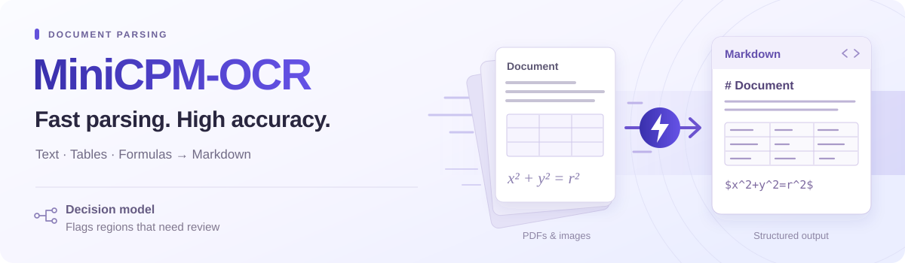
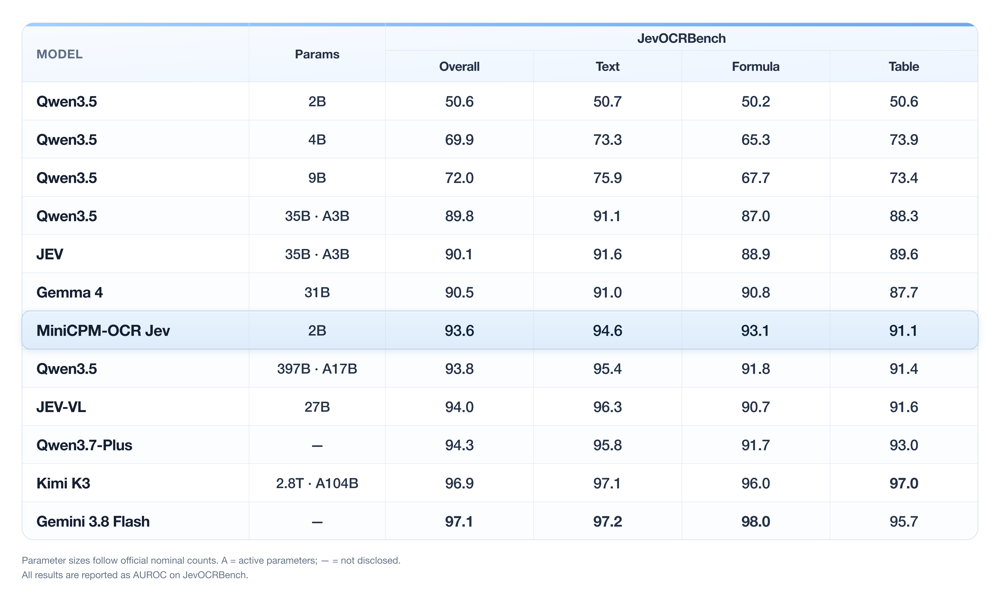
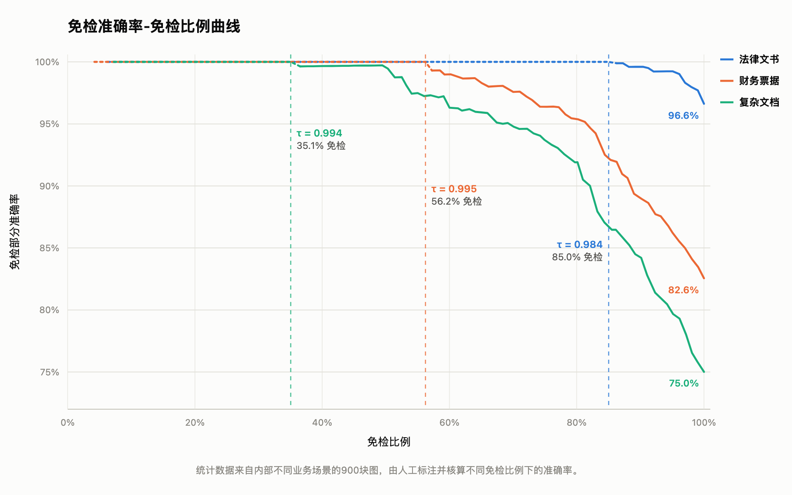
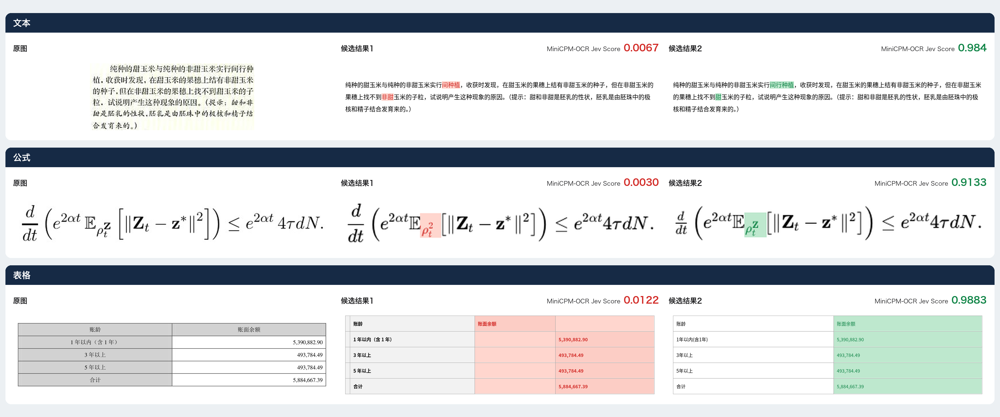

<div align="center">



<p align="center"><strong>MiniCPM-OCR · Fast, accurate parsing for real-world documents.</strong></p>

<p align="center">
  <a href="./docs/minicpm_ocr_1dot0_zh.md"><strong>MiniCPM-OCR 1.0</strong></a>&ensp;<a href="https://huggingface.co/openbmb/MiniCPM-OCR-1.0" title="Hugging Face"></a>&ensp;<a href="https://modelscope.cn/models/OpenBMB/MiniCPM-OCR-1.0" title="ModelScope"></a>
  &emsp;
  <a href="./docs/minicpm_ocr_jev_zh.md"><strong>MiniCPM-OCR Jev</strong></a>&ensp;<a href="https://huggingface.co/openbmb/MiniCPM-OCR-1.0-Jev" title="Hugging Face"></a>&ensp;<a href="https://modelscope.cn/models/OpenBMB/MiniCPM-OCR-Jev" title="ModelScope"></a>
</p>

<p align="center">
  <a href="#quick-start">开始使用</a> &nbsp;·&nbsp;
  <a href="#model-weights">模型权重</a> &nbsp;·&nbsp;
  <a href="#api">API</a> &nbsp;·&nbsp;
  <a href="#skill">Skill</a> &nbsp;·&nbsp;
  在线体验（<a href="https://platform.modelbest.cn/console/playground/document-parse">国内</a> / <a href="https://platform.modelbest.ai/console/playground/document-parse">海外</a>）
  &nbsp;|&nbsp; <a href="./README.md">English</a> &nbsp;·&nbsp; 中文
</p>

</div>

<a id="overview"></a>

**MiniCPM-OCR** 是面向高效文档解析和文字识别的系列模型。**MiniCPM-OCR 1.0** 支持中英文档与 PDF 解析，在扫描、拍照、弯曲和翻拍等复杂场景下兼顾解析质量与处理效率。**MiniCPM-OCR Jev** 对 OCR 解析结果进行区域级质量判断，识别有问题与无问题的区域，可搭配不同解析模型，帮助用户定位需要复核的内容。

## MiniCPM-OCR 1.0

**MiniCPM-OCR 1.0** (1.3B) 是 [MiniCPM-V/o](https://github.com/openbmb/MiniCPM-V) 家族首个 OCR 专用模型，面向以文字为中心的文档理解，覆盖文本、表格、公式、图表与印章识别和结构化信息抽取。主要特点包括：

- 🏆 **SOTA 的文档解析能力**：MiniCPM-OCR 1.0 在真实场景文档解析评测 **Real5-OmniDocBench 上取得 93.68 的 SOTA 成绩**，并在 OmniDocBench v1.6、Wild-OmniDocBench 和 olmOCR-Bench 等评测中展现领先的解析能力。模型支持中英双语文档与 PDF 解析，兼顾标准文档和复杂采集条件，在扫描、弯曲、拍照、倾斜及翻拍等场景下保持稳定表现。
- ⚡ **高效推理。** 基于 DSpark 解码加速（[**DSpark-BF16**](https://huggingface.co/openbmb/MiniCPM-OCR-1.0-DSpark)、[**DSpark-GGUF**](https://huggingface.co/openbmb/MiniCPM-OCR-1.0-DSpark-gguf)），MiniCPM-OCR 1.0 的**端到端处理效率提升 55%**。其处理吞吐量约为 PaddleOCR-VL-1.6 的 **1.49 倍**、MinerU2.5 Pro 的 **3.62 倍**，降低大规模文档解析的时间开销。
- 🔍 **通用识别与信息抽取**：MiniCPM-OCR 1.0 在 **OCRBench v2 上取得 54.7 的 SOTA** 成绩，具备扎实的通用 OCR 能力；**同时支持关键信息抽取（KIE）**，可根据业务需求提取文档中的关键内容，支持后续信息整理与自动化处理。
- 🛠️ **部署与开发友好**：MiniCPM-OCR 1.0 首日**适配 vLLM、SGLang、llama.cpp 和 Ollama**，同步提供多芯片适配与多种量化版本。模型**支持二次微调**，提供 **[pip SDK](#local-deployment)** 和**[功能完备的 API](#api)**，方便应用集成与定制开发，也可**[通过 SKILL.md 快速上手](#skill)**；同时提供在线体验（[国内](https://platform.modelbest.cn/console/playground/document-parse) / [海外](https://platform.modelbest.ai/console/playground/document-parse)），方便用户查看解析效果。

### SOTA 表现，更高吞吐

在图示的开源 OCR 模型对比中，MiniCPM-OCR 1.0 的解析吞吐量达到 1.2 pages/s，在 OmniDocBench v1.6、Real5-OmniDocBench、Wild-OmniDocBench 和 olmOCR-Bench 四项文档解析基准上取得最高等权平均分。

<p align="center"><a href="./assets/minicpm-ocr/efficiency-performance-zh.png"></a></p>

<sub>平均分：OmniDocBench v1.6、Real5-OmniDocBench、Wild-OmniDocBench 和 olmOCR-Bench 四项基准的等权平均分；横轴为吞吐量（页/秒），采用对数刻度。测试设置与复现说明见 [复现文档](./docs/benchmark_reproduction_zh.md)；各模型的吞吐数值见 [模型指南的吞吐评测](./docs/minicpm_ocr_1dot0_zh.md#吞吐)。</sub>

<a id="ocr-benchmark"></a>

### 各基准效果对比

<p align="center"><a href="./assets/minicpm-ocr/benchmark-radar.png"></a></p>

<details>
<summary>点击查看 MiniCPM-OCR 1.0 完整评测结果</summary>

<p align="center"><a href="./assets/minicpm-ocr/ocr-benchmarks.png"></a></p>

</details>

各基准柱状图与吞吐明细见 [OCR 模型指南](./docs/minicpm_ocr_1dot0_zh.md#评测)。

### 典型示例

从左至右依次为原始文档、检测到的版面和渲染后的 Markdown。

#### 中文文档

<p align="center"><a href="./assets/minicpm-ocr/minicpm-chinese-examples-3-column.gif"></a></p>

<details>
<summary>更多中文案例</summary>

原图与解析结果对照。

<p align="center"><a href="./assets/minicpm-ocr/minicpm-ocr-chinese-cases.png"></a></p>

</details>

#### 英文文档

<p align="center"><a href="./assets/minicpm-ocr/minicpm-english-examples-3-column.gif"></a></p>

<details>
<summary>更多英文案例</summary>

原图与解析结果对照。

<p align="center"><a href="./assets/minicpm-ocr/minicpm-ocr-english-cases.png"></a></p>

</details>

## MiniCPM-OCR Jev

**MiniCPM-OCR Jev** 是面向文本、公式和表格的 **OCR 质量判别决策模型**。输入图像及对应的 OCR 结果，即可获得 **0–1 的质量评分**，用于筛选可靠结果、定位待复核内容。

- 🛡️ **以小胜大**：仅 2B 参数，在 [JevOCRBench](https://huggingface.co/datasets/openbmb/JevOCRBench) 上决策精度 AUROC（×100）达到 93.6，**反超 JEV-35B-A3B（90.1）**，接近 Qwen3.5-397B-A17B（93.8）。
- 🧩 **稳定泛化**：在 MiniCPM-OCR 1.0、GLM-OCR、PaddleOCR-VL-1.6 和 Xiaomi-OCR-0 的解析结果上，AUROC（×100）为 **91.9–93.4**。

<a id="jev-benchmark"></a>

### 评测表现

下表展示 JevOCRBench 的整体与分类型 AUROC（×100），数值越高表示区分正确和错误解析结果的能力越强。

<p align="center"><a href="./assets/minicpm-ocr/jev-benchmark-score-table.png"></a></p>

<a id="判别力跨ocr模型泛化"></a>
<a id="使用场景"></a>
<a id="用法一块级直通省掉大部分人工核验"></a>
<a id="用法二多专家聚合扩展-ocr-的能力边界"></a>

### 免检准确率

三类文档在不同免检比例下的准确率。

<p align="center"><a href="./assets/minicpm-ocr/review-free-zh.png"></a></p>

### 判别示例

文本、公式和表格识别结果的 Jev 评分。

<p align="center"><a href="./assets/minicpm-ocr/jev-case-zh.png"></a></p>

详见 [模型指南](./docs/minicpm_ocr_jev_zh.md)、[使用场景](./docs/minicpm_ocr_jev_zh.md#使用场景)、[跨模型评测](./docs/minicpm_ocr_jev_zh.md#已验证的解析器) 和 [判别示例](./docs/minicpm_ocr_jev_zh.md#示例)。

<a id="quick-start"></a>

## MiniCPM-OCR 使用

选择适合你的 MiniCPM-OCR 1.0 和 MiniCPM-OCR Jev 接入方式：

<a id="使用-agent-skill-部署推荐"></a>

### Skill

让编码 Agent 按 MiniCPM-OCR 1.0 [skill](./docs/SKILL.md) 完成环境配置、模型下载和首次文档解析。将以下指令发送给 Agent：

```text
Read and execute https://github.com/OpenBMB/MiniCPM-OCR/blob/main/docs/SKILL.md
```

已克隆本仓库时，也可直接使用 `./docs/SKILL.md`。

### API

通过 API 接入 MiniCPM-OCR 1.0 的识别能力和 MiniCPM-OCR Jev 的质量判别能力。

[MiniCPM-OCR 1.0 调用示例](./docs/minicpm_ocr_api_zh.md) &emsp;·&emsp; [MiniCPM-OCR Jev 调用示例](./docs/minicpm_ocr_jev_api_zh.md)（即将提供）

<a id="手动部署"></a>

<a id="local-deployment"></a>

### 本地部署

在自己的设备上运行模型：MiniCPM-OCR 1.0 将 PDF 和图片解析为 Markdown 或 JSON，MiniCPM-OCR Jev 对解析结果评分。

[MiniCPM-OCR 1.0 部署教程](./docs/minicpmvocr_tutorial.md) · [MiniCPM-OCR Jev 部署教程](./docs/minicpm_ocr_jev_tutorial_zh.md)

<a id="fine-tuning"></a>

### 模型微调

| 模型 | 微调教程 |
| :--- | :--- |
| MiniCPM-OCR 1.0 | [LLaMA-Factory](./docs/llamafactory_minicpm_ocr_french.md) · [Swift](./docs/swift_minicpm_ocr_french.md) |
| MiniCPM-OCR Jev | [Swift](./docs/finetune_jev_zh.md) |

<a id="resources"></a>
<a id="model-weights"></a>

## 模型权重

<table border="1" cellspacing="0" cellpadding="8">
<tr>
<td nowrap>模型</td>
<td width="360">简介</td>
<td nowrap width="170">主模型权重下载</td>
<td nowrap width="150">DSpark 采样头</td>
</tr>
<tr>
<td nowrap>MiniCPM&#8209;OCR&nbsp;<strong>1.0</strong></td>
<td width="360">面向高效文档解析和文字识别场景，支持中英文档与 PDF 解析，在扫描、拍照、弯曲和翻拍等复杂场景下兼顾解析质量与处理效率。</td>
<td nowrap><a href="https://huggingface.co/openbmb/MiniCPM-OCR-1.0">🤗</a>&nbsp;&nbsp;<a href="https://modelscope.cn/models/OpenBMB/MiniCPM-OCR-1.0"></a>&nbsp;<strong>BF16</strong><br><a href="https://huggingface.co/openbmb/MiniCPM-OCR-1.0-gguf">🤗</a>&nbsp;&nbsp;<a href="https://modelscope.cn/models/OpenBMB/MiniCPM-OCR-1.0-gguf"></a>&nbsp;<strong>GGUF</strong><br><a href="https://huggingface.co/openbmb/MiniCPM-OCR-1.0-AWQ">🤗</a>&nbsp;&nbsp;<a href="https://modelscope.cn/models/OpenBMB/MiniCPM-OCR-1.0-AWQ"></a>&nbsp;<strong>AWQ</strong><br><a href="https://huggingface.co/openbmb/MiniCPM-OCR-1.0-GPTQ">🤗</a>&nbsp;&nbsp;<a href="https://modelscope.cn/models/OpenBMB/MiniCPM-OCR-1.0-GPTQ"></a>&nbsp;<strong>GPTQ</strong></td>
<td nowrap><a href="https://huggingface.co/openbmb/MiniCPM-OCR-1.0-DSpark">🤗</a>&nbsp;&nbsp;<a href="https://modelscope.cn/models/OpenBMB/MiniCPM-OCR-1.0-DSpark"></a>&nbsp;<strong>BF16</strong><br><a href="https://huggingface.co/openbmb/MiniCPM-OCR-1.0-DSpark-gguf">🤗</a>&nbsp;&nbsp;<a href="https://modelscope.cn/models/OpenBMB/MiniCPM-OCR-1.0-DSpark-gguf"></a>&nbsp;<strong>GGUF</strong></td>
</tr>
<tr>
<td nowrap>MiniCPM&#8209;OCR&nbsp;<strong>Jev</strong></td>
<td width="360">面向文本、公式和表格的 OCR 质量判别模型，输入图像及 OCR 结果即可获得 0–1 的质量评分。</td>
<td align="center" valign="middle" colspan="2"><a href="https://huggingface.co/openbmb/MiniCPM-OCR-1.0-Jev">🤗</a>&nbsp;&nbsp;<a href="https://modelscope.cn/models/OpenBMB/MiniCPM-OCR-Jev"></a>&nbsp;<strong>BF16</strong>&emsp;<a href="https://huggingface.co/openbmb/MiniCPM-OCR-1.0-Jev-gguf">🤗</a>&nbsp;&nbsp;<a href="https://modelscope.cn/models/OpenBMB/MiniCPM-OCR-Jev-gguf"></a>&nbsp;<strong>GGUF</strong><br><a href="https://huggingface.co/openbmb/MiniCPM-OCR-1.0-Jev-AWQ">🤗</a>&nbsp;&nbsp;<a href="https://modelscope.cn/models/OpenBMB/MiniCPM-OCR-Jev-AWQ"></a>&nbsp;<strong>AWQ</strong>&emsp;<a href="https://huggingface.co/openbmb/MiniCPM-OCR-1.0-Jev-GPTQ">🤗</a>&nbsp;&nbsp;<a href="https://modelscope.cn/models/OpenBMB/MiniCPM-OCR-Jev-GPTQ"></a>&nbsp;<strong>GPTQ</strong></td>
</tr>
</table>

## 💡 常见问题与排查

安装、模型下载、显存、输入格式与输出异常等常见问题汇总在 [FAQ](./docs/faq_zh.md)。

## 📄 许可

本项目整体采用 [Apache License 2.0](./LICENSE) 开源，包括代码、文档，以及 MiniCPM-OCR 1.0、MiniCPM-OCR Jev 等模型权重。
