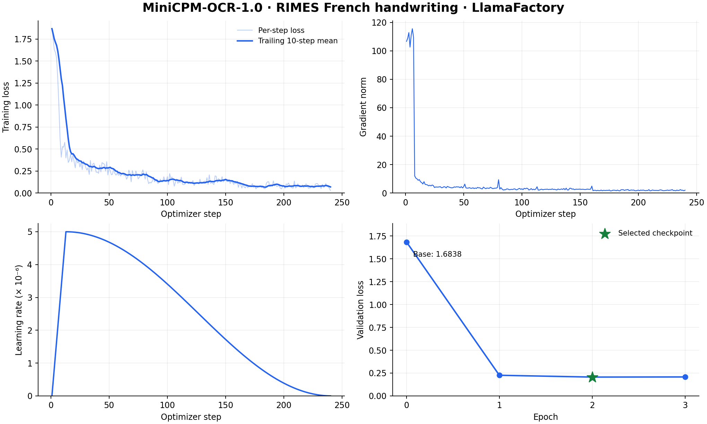

# MiniCPM-OCR 1.0 Fine-Tuning Tutorial (LlamaFactory)

[中文版](llamafactory_minicpm_ocr_french.md)

## Model and Task Overview

This tutorial uses the [Teklia/RIMES-2011-line](https://huggingface.co/datasets/Teklia/RIMES-2011-line) dataset as an example of fine-tuning [MiniCPM-OCR 1.0](https://huggingface.co/openbmb/MiniCPM-OCR-1.0) for French handwritten text-line recognition.

Training task:

- Input a French handwritten text-line image with the prompt `Text Recognition:`.
- The target `assistant` response is the corresponding French transcription.

This training run uses full-parameter SFT to train the vision encoder and language model while freezing the multimodal projector, with 4x visual token compression.

## Environment Setup

Source: [tsjyma/LlamaFactory](https://github.com/tsjyma/LlamaFactory)

**Minimum runnable installation steps**

```bash
conda create -n "MiniCPM-OCR-French-LF" python=3.11 -y
conda activate "MiniCPM-OCR-French-LF"

pip install torch==2.9.1 torchvision==0.24.1 torchaudio==2.9.1

git clone https://github.com/tsjyma/LlamaFactory.git
cd LlamaFactory
git checkout 38fa4bcbac2830c159f2baf9808d21a7fca4e790
pip install -e .

pip install \
  accelerate==1.13.0 deepspeed==0.18.8 \
  peft==0.18.1 trl==0.24.0 datasets==4.0.0 \
  flash-linear-attention==0.4.2 \
  ninja einops safetensors tokenizers sentencepiece

pip install /path/to/transformers
export DISABLE_VERSION_CHECK=1
```

Install the latest Transformers source last (> 5.20.2).

**Reference dependency versions**

```text
Python                    3.11.11
PyTorch                   2.9.1+cu128
torchvision               0.24.1
torchaudio                2.9.1
Transformers              > 5.20.2
DeepSpeed                 0.18.8
Accelerate                1.13.0
PEFT                      0.18.1
TRL                       0.24.0
flash-linear-attention    0.4.2
datasets                  4.0.0
LlamaFactory              0.9.6.dev0
```

## Data Preparation

Use the official RIMES training, validation, and test splits.

- Exclude training samples that contain the `¤` annotation marker. For validation and test samples, remove only the delimiter and keep the text, while preserving case, accents, punctuation, internal spaces, and the original text-line images.

| Dataset | Samples |
| --- | ---: |
| Training | 10,138 |
| Validation | 1,138 |
| Test | 778 |

After downloading the dataset, pair each image path with its transcription in the JSONL format below.

**Data format reference**


```json
{
  "messages": [
    {
      "role": "user",
      "content": "<image>\nText Recognition:"
    },
    {
      "role": "assistant",
      "content": "J'ai perdu mon emploi depuis 3 mois et je me"
    }
  ],
  "images": [
    "/path/to/rimes_french/images/train/00000.jpg"
  ]
}
```

Register the training and validation datasets in `dataset_info.json`:

```json
{
  "rimes_train": {
    "file_name": "train.jsonl",
    "formatting": "sharegpt",
    "columns": {
      "messages": "messages",
      "images": "images"
    },
    "tags": {
      "role_tag": "role",
      "content_tag": "content",
      "user_tag": "user",
      "assistant_tag": "assistant"
    }
  },
  "rimes_validation": {
    "file_name": "validation.jsonl",
    "formatting": "sharegpt",
    "columns": {
      "messages": "messages",
      "images": "images"
    },
    "tags": {
      "role_tag": "role",
      "content_tag": "content",
      "user_tag": "user",
      "assistant_tag": "assistant"
    }
  }
}
```

## Launch Training

Train for three epochs on one node with 8 × A100 80GB GPUs: 80 updates per epoch and 240 updates in total. Per-device batch size 1 and gradient accumulation 16 give a global batch size of 128. Evaluate on the complete validation set and save a checkpoint after each epoch, then select the checkpoint with the lowest validation loss.

- Training appends `<think>\n\n</think>\n\n`. User text, image tokens, and the empty thinking prefix are masked from loss; the answer and end markers are supervised.

Run the following script after Environment Setup:

```bash
set -euo pipefail
export CUDA_VISIBLE_DEVICES="${CUDA_VISIBLE_DEVICES:-0,1,2,3,4,5,6,7}"
export FORCE_TORCHRUN=1 NPROC_PER_NODE=8
export MASTER_ADDR=127.0.0.1 MASTER_PORT=29780
export DOWNSAMPLE_MODE=4x
export DISABLE_VERSION_CHECK=1

DOC_DIR=/path/to/ocr_doc
DATA_DIR=/path/to/rimes_french
OUTPUT_DIR=/path/to/outputs/minicpm_ocr_french_llamafactory
mkdir -p "$OUTPUT_DIR"

cat > "$OUTPUT_DIR/train.yaml" <<YAML
model_name_or_path: /path/to/MiniCPM-OCR-1.0
trust_remote_code: false
flash_attn: sdpa
use_reentrant_gc: false
stage: sft
do_train: true
finetuning_type: full
freeze_vision_tower: false
freeze_multi_modal_projector: true
dataset_dir: ${DATA_DIR}
dataset: rimes_train
template: minicpm_ocr
enable_thinking: false
train_on_prompt: false
cutoff_len: 4096
packing: false
preprocessing_num_workers: 8
dataloader_num_workers: 8
output_dir: ${OUTPUT_DIR}
logging_steps: 1
save_strategy: epoch
save_only_model: false
save_total_limit: 3
report_to: none
per_device_train_batch_size: 1
gradient_accumulation_steps: 16
learning_rate: 5.0e-06
num_train_epochs: 3.0
lr_scheduler_type: cosine
warmup_steps: 0.05
bf16: true
ddp_find_unused_parameters: true
seed: 42
data_seed: 42
eval_strategy: epoch
weight_decay: 0.1
do_eval: true
deepspeed: ${DOC_DIR}/assets/minicpm-ocr/ds_zero2.json
optim: adamw_torch_fused
adam_beta1: 0.9
adam_beta2: 0.95
adam_epsilon: 1.0e-08
max_grad_norm: 1.0
overwrite_cache: true
eval_dataset: rimes_validation
load_best_model_at_end: true
metric_for_best_model: eval_loss
greater_is_better: false
per_device_eval_batch_size: 1
YAML

llamafactory-cli train "$OUTPUT_DIR/train.yaml"
```

## Training Curves



| Epochs | Updates | Training time | Mean training loss |
| ---: | ---: | --- | ---: |
| 3 | 240 | 33m 52s | 0.203473 |

| Model | Epoch | Validation loss ↓ |
| --- | ---: | ---: |
| MiniCPM-OCR 1.0 | 0 | 1.683845 |
| Fine-tuned model | 1 | 0.225827 |
| Fine-tuned model | 2 | 0.206137 |
| Fine-tuned model | 3 | 0.207547 |

Select `checkpoint-160` at epoch two. The evaluation results below use this checkpoint.

## Evaluation Results

Evaluate on all 778 official RIMES test lines. Both the base and fine-tuned model use 4x visual token compression, non-thinking mode, greedy decoding, batch size 8, and a maximum of 512 newly generated tokens per line. Use the same prompt, `Text Recognition:`, as in training.

Evaluation metrics:

| Metric | Description |
| --- | --- |
| CER ↓ | Character error rate: total character edit distance divided by the total number of reference characters. Lower is better. |
| WER ↓ | Word error rate: total word edit distance divided by the total number of reference words, using whitespace-delimited words. Lower is better. |

Both metrics use complete model outputs, normalize Unicode to NFC, trim leading/trailing whitespace, and preserve case, accents, punctuation, and internal spaces.

| Model | RIMES CER ↓ | RIMES WER ↓ |
| --- | ---: | ---: |
| MiniCPM-OCR 1.0 | 5.67% | 15.78% |
| Fine-tuned model | 2.98% | 7.66% |

**Output examples**

The examples below are actual outputs from the selected checkpoint on RIMES test images.

**Example 1: Insurance contract**


```text
# Question
<image>
Text Recognition:

# Fine-tuned model
Comme indiqué dans les conditions particulières de mon contrat d'assurance
```

**Example 2: Address and date**


```text
# Question
<image>
Text Recognition:

# Fine-tuned model
de mon domicile du 3 Rue Gambetta, 57000 METZ, en date du 28 février
```
