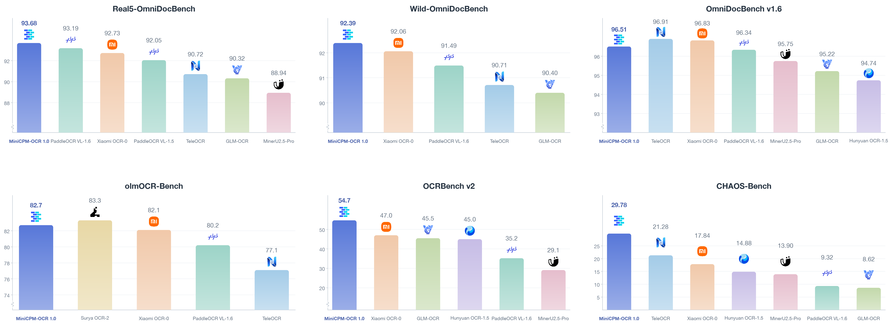
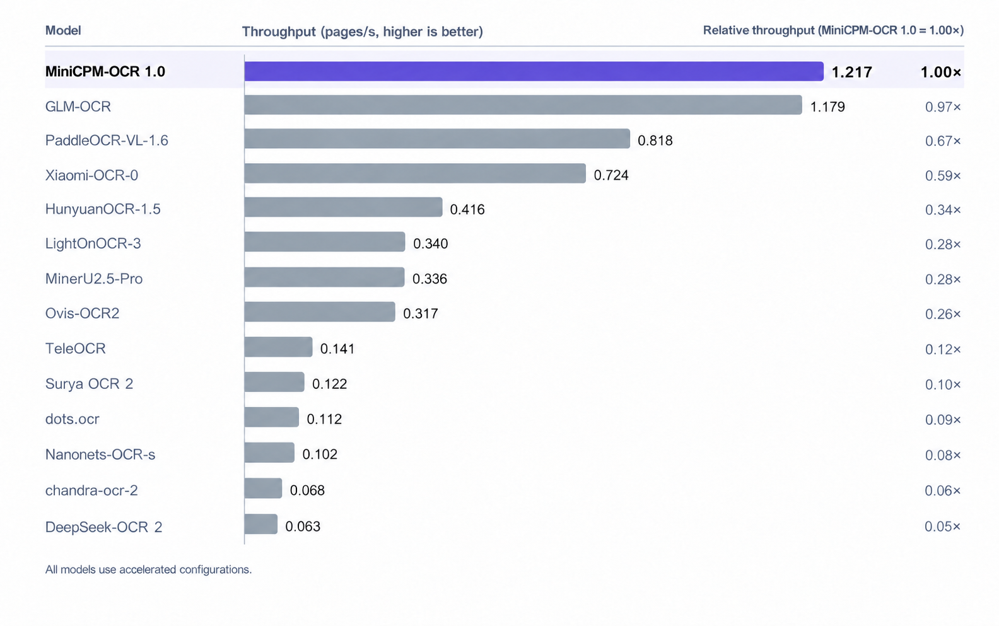

# MiniCPM-OCR 1.0

[中文版](./minicpm_ocr_1dot0_zh.md)

[← Back to the homepage](../README.md) · [MiniCPM-OCR Jev](./minicpm_ocr_jev_en.md)

MiniCPM-OCR 1.0 is a **1.3B** model for document parsing, text recognition, and key information extraction. This page covers its highlights, architecture, document parsing and KIE usage, deployment options, and benchmark breakdowns; see the [README](../README.md#ocr-benchmark) for complete experimental results.

## Model Highlights

- 🏆 **SOTA document parsing**: MiniCPM-OCR 1.0 achieves a **SOTA score of 93.68 on Real5-OmniDocBench**, a benchmark for real-world document parsing, and demonstrates leading parsing capabilities on OmniDocBench v1.6, Wild-OmniDocBench, and olmOCR-Bench. It supports Chinese and English documents and PDFs, handling both standard documents and challenging capture conditions, including scans, curved pages, photographs, skewed pages, and recaptured documents.
- ⚡ **Efficient inference.** With DSpark decoding acceleration ([**DSpark-BF16**](https://huggingface.co/openbmb/MiniCPM-OCR-1.0-DSpark), [**DSpark-GGUF**](https://huggingface.co/openbmb/MiniCPM-OCR-1.0-DSpark-gguf)), MiniCPM-OCR 1.0 improves **end-to-end processing efficiency by 55%**. Its throughput is approximately **1.49×** that of PaddleOCR-VL-1.6 and **3.62×** that of MinerU2.5 Pro, reducing the time needed for large-scale document parsing.
- 🔍 **General recognition and information extraction**: MiniCPM-OCR 1.0 achieves a **SOTA score of 54.7 on OCRBench v2**, demonstrating strong general OCR capabilities. It also supports key information extraction (KIE), extracting relevant document content for downstream information management and automated processing.
- 🛠️ **Easy deployment and development**: MiniCPM-OCR 1.0 supports **vLLM, SGLang, llama.cpp, and Ollama from day one**, with multiple chip platforms and quantized versions available at release. It **supports further fine-tuning** and provides a **[pip SDK](../README.md#local-deployment)** and a **[full-featured API](../README.md#api)** for application integration and customization. You can also **[get started quickly with SKILL.md](../README.md#skill)**. Try the Online Demo ([CN](https://platform.modelbest.cn/console/playground/document-parse) / [Global](https://platform.modelbest.ai/console/playground/document-parse)) to explore parsing results.

## Model Base and Architecture

MiniCPM-OCR 1.0 is **specialized for OCR through training based on MiniCPM-V 4.6**. The standard model combines a **SigLIP vision encoder and a Qwen3.5 language model** and runs with the accompanying Transformers 5 model integration.

| Item | Description |
| :--- | :--- |
| Parameters | 1.3B |
| Primary languages | Chinese and English |
| Recognition tasks | Text, tables, formulas, charts, seals, and key information extraction |
| Document parsing components | MiniCPM-OCR 1.0 recognition model + PP-DocLayoutV3 layout model + `minicpmvocr` SDK |

<!-- The model base description follows flagos_deploy_zh.md; the architecture description follows minicpmvocr_tutorial.md. The exact initial checkpoint, original training data, and training stages are not yet supported by verifiable material and are not inferred from the architecture name. -->

## Document Parsing Workflow

The SDK parses complete documents, while the recognition model processes their image regions:

1. **Read the document**: The SDK accepts PDF, PNG, or JPG files and converts PDF pages to images.
2. **Analyze the layout**: PP-DocLayoutV3 detects document regions and analyzes reading order; the SDK crops the regions.
3. **Recognize the content**: The SDK sends document regions to the MiniCPM-OCR 1.0 inference service and recognizes them concurrently.
4. **Assemble the output**: The SDK combines results into Markdown in reading order, converts OTSL table representations to HTML, and preserves formulas as LaTeX.

The SDK and inference service use separate Python environments and may run on different machines. The SDK handles layout detection, cropping, and result assembly; the inference backend handles model recognition. See the [SDK tutorial](./minicpmvocr_tutorial_en.md) for installation and configuration.

### Single-Region Recognition

If layout regions have already been extracted, call the recognition service directly. Use a cropped image and the prompt corresponding to its region type:

| Region | Prompt | Result handling |
| :--- | :--- | :--- |
| Text | `Text Recognition:` | Returns recognized text |
| Table | `Table Recognition:` | The raw format depends on the model version; the SDK can handle table postprocessing |
| Formula | `Formula Recognition:` | Check that the LaTeX content and structure are complete |
| Seal | `Seal Recognition:` | Returns the recognized seal text |
| Chart | `Chart to Table:` | Converts chart content into a table |

See the [API example](./vllm_deploy_en.md#22-image-recognition) for a complete request and response checks. If `finish_reason` is `length`, check for truncated output and adjust the output budget.

<a id="kie"></a>

## Key Information Extraction (KIE)

MiniCPM-OCR 1.0 supports extracting specified fields from images, such as the store name and amount on a receipt. Send the image and a field extraction prompt directly to the recognition service, requesting a JSON object keyed by the field names. KIE can process the input image directly without generating full-document Markdown first.

Follow the [image recognition API example](./vllm_deploy_en.md#22-image-recognition) and replace `Text Recognition:` in the request with:

```text
Extract the "store_name", "amount". Format the output as a JSON object with keys: "store_name", "amount". If an item is not in the image, use "###".
```

Replace both field lists with the fields needed for your application, keeping their names consistent; field names can be in Chinese or English. The prompt requests `"###"` for fields absent from the image. The response is model-generated text; parse the JSON and check its fields and values before using it downstream.

## Model Weights

See [Model Weights in the README](../README.md#model-weights) for standard, GGUF-quantized, and DSpark downloads. FlagOS-adapted BF16 versions for multiple chips are listed in the [download table](./flagos_deploy_en.md#model-downloads).

**DSpark requires matching main and draft models from the same release** and must not be mixed with standard-model weights. See [DSpark acceleration](./minicpmvocr_tutorial_en.md#3-start-the-service) for weight selection and startup arguments.

## Inference

For your first PDF or image, start with the [SDK tutorial](./minicpmvocr_tutorial_en.md). If a recognition service is already running, configure the SDK to connect to its address.

| Inference option | Guide |
| :--- | :--- |
| vLLM | [API service and single-region recognition](./vllm_deploy_en.md) |
| Transformers | [Transformers service deployment](./SKILL_en.md#43-transformers-serve) |
| SGLang | [Deployment guide](./sglang_deploy.md) |
| llama.cpp | [GGUF deployment guide](./llamacpp_deploy.md) |
| Ollama | [SDK service connection and backend configuration](./minicpmvocr_api_en.md#command-line-options) |
| FlagOS | [Multi-chip deployment guide](./flagos_deploy_en.md) |

The SDK's `pipeline.max_workers` controls recognition-region requests, while `pipeline.page_workers` controls page concurrency. Configure both to match the backend's capacity: the current DSpark example uses `--max-num-seqs 32` as its per-instance concurrency limit. See the [SDK tutorial](./minicpmvocr_tutorial_en.md#4-parse-documents) for multiple instances and concurrency configuration.

## Fine-Tuning

The [LLaMA-Factory](./llamafactory_minicpm_ocr_french_en.md) and [ms-swift](./swift_minicpm_ocr_french_en.md) tutorials cover data preparation, training, and evaluation using French handwritten text-line recognition. The example uses full-parameter SFT, trains the vision encoder and language model while freezing the multimodal projector, and applies 4× visual token compression. These settings apply to the fine-tuning experiment in those tutorials.

## Evaluation

The figure below compares results on six benchmarks. Each panel retains its benchmark's original scores; higher is better. Scores from different benchmarks should not be compared directly.

<p align="center"><a href="../assets/minicpm-ocr/benchmark-comparison.png"></a></p>

The figure includes selected models to show differences across benchmarks. See the [complete experimental table in the README](../README.md#ocr-benchmark) for all 14 models.

## Throughput

On an NVIDIA GeForce RTX 5090, using all 1,651 images in OmniDocBench v1.6, image-level concurrency of 1, and each system's accelerated configuration, MiniCPM-OCR 1.0 achieves **1.2 pages/s**. Relative throughput is normalized to MiniCPM-OCR 1.0 at **1.00×**; a higher value indicates faster processing.

<p align="center"><a href="../assets/minicpm-ocr/throughput-comparison.png"></a></p>

These are parsing throughput results; the exact timing boundaries remain to be documented. With image-level concurrency set to 1, recognition regions within a page can still be processed concurrently. Deployment speed also depends on page content, backend, concurrency, and hardware configuration.

## Reproduction

See the [reproduction guide](./benchmark_reproduction_en.md) for test settings, DSpark comparison requirements, and evaluation details still to be added. Recorded SDK test environments are listed under [Verified versions](./SKILL_en.md#9-verified-versions).

## License

MiniCPM-OCR 1.0 model weights, code, and documentation are released under the [Apache License 2.0](../LICENSE).
