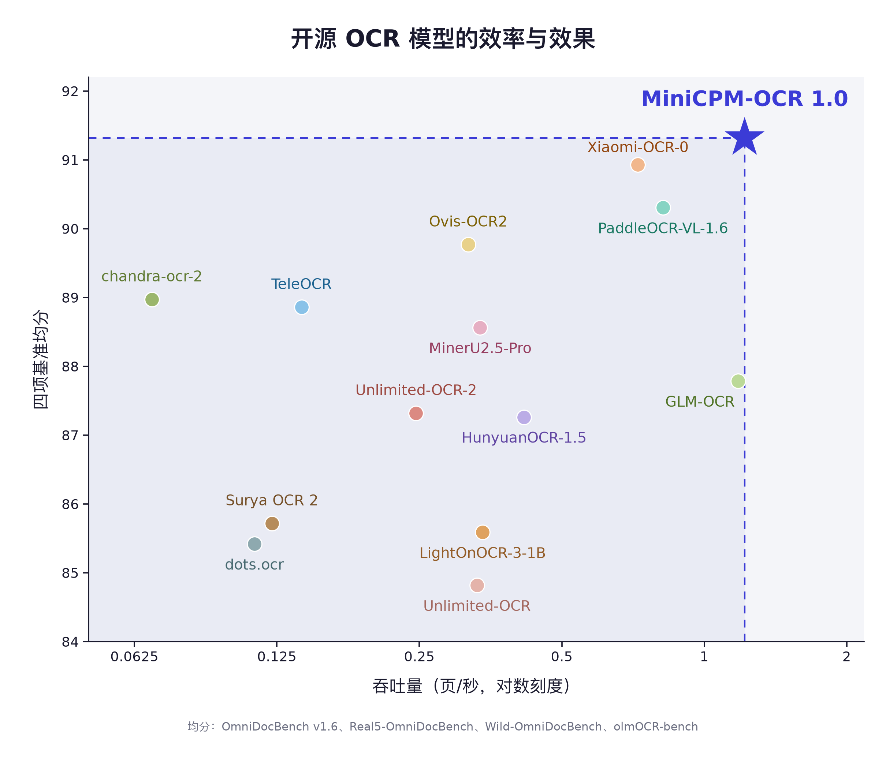
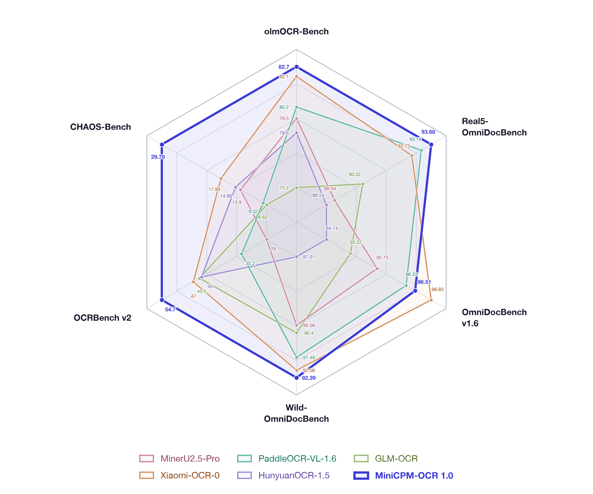
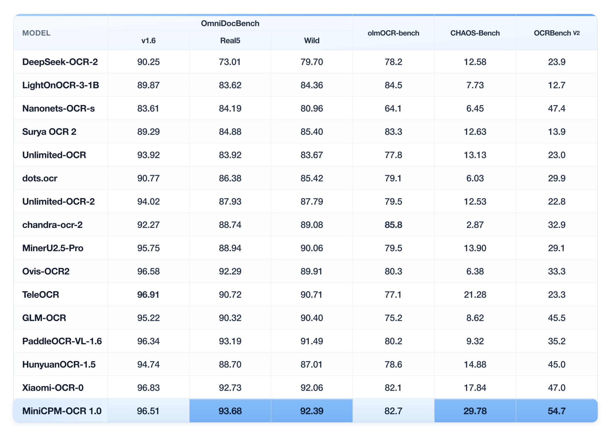
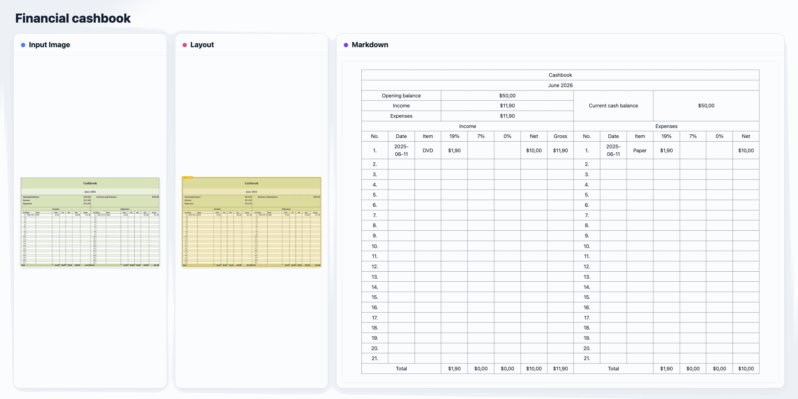
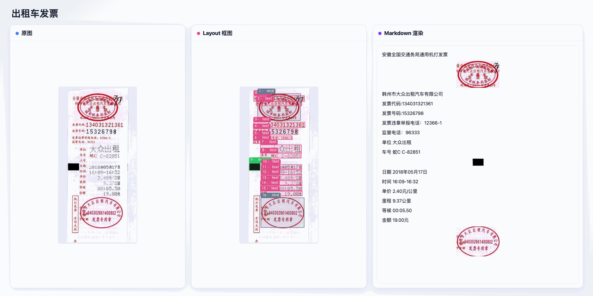

# MiniCPM-OCR 1.0

[English](./minicpm_ocr_1dot0_en.md)

[← 返回首页](../README_zh.md) · [MiniCPM-OCR Jev](./minicpm_ocr_jev_zh.md)

**MiniCPM-OCR 1.0**（1.3B）是 [MiniCPM-V/o](https://github.com/openbmb/MiniCPM-V) 家族首个 OCR 专用模型，面向以文字为中心的文档理解，覆盖文本、表格、公式、图表与印章识别和结构化信息抽取。本页介绍模型亮点、技术规格、使用方法、模型下载、完整评测、效率结果和典型示例。

## 模型亮点

- 🏆 **SOTA 的文档解析能力**：MiniCPM-OCR 1.0 在真实场景文档解析评测 **Real5-OmniDocBench 上取得 93.68 的 SOTA 成绩**，并在 OmniDocBench v1.6、Wild-OmniDocBench 和 olmOCR-Bench 等评测中展现领先的解析能力。模型支持中英双语文档与 PDF 解析，兼顾标准文档和复杂采集条件，在扫描、弯曲、拍照、倾斜及翻拍等场景下保持稳定表现。
- ⚡ **高效推理。** 基于 DSpark 解码加速（[**DSpark-BF16**](https://huggingface.co/openbmb/MiniCPM-OCR-1.0-DSpark)、[**DSpark-GGUF**](https://huggingface.co/openbmb/MiniCPM-OCR-1.0-DSpark-gguf)），MiniCPM-OCR 1.0 的**端到端处理效率提升 55%**。其处理吞吐量约为 PaddleOCR-VL-1.6 的 **1.49 倍**、MinerU2.5 Pro 的 **3.62 倍**，降低大规模文档解析的时间开销。
- 🔍 **通用识别与信息抽取**：MiniCPM-OCR 1.0 在 **OCRBench v2 上取得 54.7 的 SOTA** 成绩，具备扎实的通用 OCR 能力；**同时支持关键信息抽取（KIE）**，可根据业务需求提取文档中的关键内容，支持后续信息整理与自动化处理。
- 🛠️ **部署与开发友好**：MiniCPM-OCR 1.0 首日**适配 vLLM、SGLang、llama.cpp 和 Ollama**，同步提供多芯片适配与多种量化版本。模型**支持二次微调**，提供 **[pip SDK](https://pypi.org/project/minicpm-ocr/)** 和 **[功能完备的 API](./minicpm_ocr_api_zh.md)**，方便应用集成与定制开发，也可 **[通过 SKILL.md 快速上手](./SKILL.md)**；同时提供在线体验（[国内](https://platform.modelbest.cn/console/playground/document-parse) / [海外](https://platform.modelbest.ai/console/playground/document-parse)），方便用户查看解析效果。

## 使用方式

### Skill

让编码 Agent 按 [skill](./SKILL.md) 完成环境配置、模型下载和首次文档解析。将以下指令发送给 Agent：

```text
Read and execute https://github.com/OpenBMB/MiniCPM-OCR/blob/main/docs/SKILL.md
```

已克隆本仓库时，也可直接使用 `./docs/SKILL.md`。

### 免费 API

通过免费 API 接入 MiniCPM-OCR 1.0 的识别能力，见 [API 调用示例](./minicpm_ocr_api_zh.md)。

### 本地部署

在自己的设备上运行模型，将 PDF 和图片解析为 Markdown 或 JSON，见 [SDK 使用与部署教程](./minicpmvocr_tutorial.md)。[推理](#推理)章节列出了各后端的部署入口。

## 模型基座与结构

MiniCPM-OCR 1.0 **基于 MiniCPM-V 4.6 进行 OCR 特化训练**。标准模型由 **SigLIP 视觉编码器与 Qwen3.5 语言模型**组成，通过配套的 Transformers 5 模型适配运行。

| 项目 | 说明 |
| :--- | :--- |
| 参数量 | 1.3B |
| 主要语言 | 中文、英文 |
| 识别任务 | 文本、表格、公式、图表、印章识别与关键信息抽取 |
| 文档解析组件 | MiniCPM-OCR 1.0 识别模型 + PP-DocLayoutV3 版面模型 + `minicpmvocr` SDK |

<!-- 基座说明据 flagos_deploy_zh.md；架构说明据 minicpmvocr_tutorial.md。精确初始检查点、原始训练数据与训练阶段尚无可核实材料，不据架构名称推断。 -->

## 文档解析流程

完整文档通过 SDK 解析，识别模型处理其中的图像块：

1. **读取文档**：SDK 接收 PDF、PNG 或 JPG，将 PDF 页面转为图像。
2. **分析版面**：PP-DocLayoutV3 检测文档区域并分析阅读顺序，SDK 按区域切块。
3. **识别内容**：SDK 将文档块发送给 MiniCPM-OCR 1.0 推理服务，并发识别各区域。
4. **组织输出**：SDK 按阅读顺序拼接为 Markdown，将表格的 OTSL 表示转换为 HTML，公式保留为 LaTeX。

SDK 与推理服务使用独立的 Python 环境，也可部署在不同机器上。SDK 负责版面检测、切块和结果整理，推理后端负责模型识别；安装与配置见 [SDK 使用教程](./minicpmvocr_tutorial.md)。

### 单块识别

已有版面切分结果时，可直接调用识别服务。建议按区域类型使用裁切后的图像和对应提示词：

| 区域 | 提示词 | 结果处理 |
| :--- | :--- | :--- |
| 文本 | `Text Recognition:` | 返回识别文本 |
| 表格 | `Table Recognition:` | 原始格式以模型版本为准；SDK 可完成表格后处理 |
| 公式 | `Formula Recognition:` | 检查 LaTeX 内容与结构是否完整 |
| 印章 | `Seal Recognition:` | 返回印章文字 |
| 图表 | `Chart to Table:` | 将图表内容转换为表格 |

完整请求与响应检查方法见 [API 调用示例](./vllm_deploy.md#22-图片识别)。若响应的 `finish_reason` 为 `length`，需检查输出是否截断并调整输出预算。

<a id="kie"></a>

## 关键信息抽取（KIE）

MiniCPM-OCR 1.0 支持按指定字段从图片中抽取信息，例如票据中的店名和金额。将图片与字段提示词直接发送给识别服务，要求模型输出以字段名为键的 JSON 对象。KIE 可直接处理输入图片，无需先生成全文 Markdown。

沿用 [API 图片识别示例](./vllm_deploy.md#22-图片识别)，将请求中的 `Text Recognition:` 替换为：

```text
Extract the "店名", "金额". Format the output as a JSON object with keys: "店名", "金额". If an item is not in the image, use "###".
```

按业务需要替换两处字段列表，并保持字段名称一致；字段名可以使用中文或英文。提示词要求图片中不存在的字段使用 `"###"`。返回内容是模型生成的文本，接入后续程序前应解析 JSON，并核对字段和值。

## 模型权重

| 权重 | Hugging Face | ModelScope |
| :--- | :--- | :--- |
| 主模型 BF16 | [下载](https://huggingface.co/openbmb/MiniCPM-OCR-1.0) | [下载](https://modelscope.cn/models/OpenBMB/MiniCPM-OCR-1.0) |
| 主模型 GGUF | [下载](https://huggingface.co/openbmb/MiniCPM-OCR-1.0-gguf) | [下载](https://modelscope.cn/models/OpenBMB/MiniCPM-OCR-1.0-gguf) |
| 主模型 AWQ | [下载](https://huggingface.co/openbmb/MiniCPM-OCR-1.0-AWQ) | [下载](https://modelscope.cn/models/OpenBMB/MiniCPM-OCR-1.0-AWQ) |
| 主模型 GPTQ | [下载](https://huggingface.co/openbmb/MiniCPM-OCR-1.0-GPTQ) | [下载](https://modelscope.cn/models/OpenBMB/MiniCPM-OCR-1.0-GPTQ) |
| DSpark 采样头 BF16 | [下载](https://huggingface.co/openbmb/MiniCPM-OCR-1.0-DSpark) | [下载](https://modelscope.cn/models/OpenBMB/MiniCPM-OCR-1.0-DSpark) |
| DSpark 采样头 GGUF | [下载](https://huggingface.co/openbmb/MiniCPM-OCR-1.0-DSpark-gguf) | [下载](https://modelscope.cn/models/OpenBMB/MiniCPM-OCR-1.0-DSpark-gguf) |

**DSpark 需要主模型与配套的草稿模型（采样头）共同运行**。例如，BF16 部署将 `openbmb/MiniCPM-OCR-1.0` 与 `openbmb/MiniCPM-OCR-1.0-DSpark` 搭配使用；普通解码无需草稿模型。权重选择与启动参数见 [DSpark 加速说明](./minicpmvocr_tutorial.md#3-启动服务)。FlagOS 适配的 BF16 多芯片版本见 [下载列表](./flagos_deploy_zh.md#model-downloads)。

## 推理

首次解析 PDF 或图片，可从 [SDK 使用教程](./minicpmvocr_tutorial.md) 开始；已有识别服务时，只需配置 SDK 连接对应地址。

| 推理方式 | 使用说明 |
| :--- | :--- |
| vLLM | [API 服务与单块识别](./vllm_deploy.md) |
| Transformers | [Transformers 服务部署](./SKILL.md#43-transformers-serve) |
| SGLang | [部署指南（英文）](./sglang_deploy.md) |
| llama.cpp | [GGUF 部署指南（英文）](./llamacpp_deploy.md) |
| Ollama | [SDK 服务连接与后端配置](./minicpmvocr_api.md#命令行参数) |
| FlagOS | [多芯片部署指南](./flagos_deploy_zh.md) |

SDK 的 `pipeline.max_workers` 控制识别块请求数，`pipeline.page_workers` 控制页面并发。两者需结合后端能力设置：当前 DSpark 示例使用 `--max-num-seqs 32` 设置单实例并发上限；多实例部署与并发配置见 [SDK 教程](./minicpmvocr_tutorial.md#4-解析文档)。

## 二次微调

[LLaMA-Factory](./llamafactory_minicpm_ocr_french.md) 和 [ms-swift](./swift_minicpm_ocr_french.md) 教程以法语手写文本行识别为例，覆盖数据准备、训练和评测。该示例采用全参数 SFT，训练视觉编码器和语言模型、冻结多模态投影层，并使用 4× 视觉 Token 压缩；这些设置适用于教程中的二次微调实验。

## 评测

### SOTA 表现，更高吞吐

在图示的开源 OCR 模型对比中，MiniCPM-OCR 1.0 的解析吞吐量达到 1.2 pages/s，在 OmniDocBench v1.6、Real5-OmniDocBench、Wild-OmniDocBench 和 olmOCR-Bench 四项文档解析基准上取得最佳综合表现。

<p align="center"><a href="../assets/minicpm-ocr/efficiency-performance-zh.png"></a></p>

<sub>测试设置与复现说明见 [复现文档](./benchmark_reproduction_zh.md)；各模型的吞吐数值见[吞吐评测](#吞吐)。</sub>

### 各基准效果对比

<p align="center"><a href="../assets/minicpm-ocr/benchmark-radar.png"></a></p>

下图展示六项基准的分项对比，各面板保留对应基准的原始分数，分数越高越好。不同基准的分数不宜直接相互比较。

<p align="center"><a href="../assets/minicpm-ocr/benchmark-comparison.png"></a></p>

图中选取部分模型展示分项差异，完整评测结果如下。

<details>
<summary>点击查看 MiniCPM-OCR 1.0 完整评测结果</summary>

<p align="center"><a href="../assets/minicpm-ocr/ocr-benchmarks.png"></a></p>

</details>

## 吞吐

### 单并发下的系统对比

在 NVIDIA GeForce RTX 5090 上，使用 OmniDocBench v1.6 的 1,651 张图像、图片级并发度为 1，并启用各系统加速配置时，MiniCPM-OCR 1.0 的吞吐为 **1.2 pages/s**。相对吞吐以 MiniCPM-OCR 1.0 为 **1.00×**，数值越高表示处理速度越快。

<p align="center"><a href="../assets/minicpm-ocr/throughput-comparison.png"></a></p>

详细吞吐与延迟对比如下。Pages / s 越高越好（↑）；P95、P99 分别表示样本处理耗时的第 95、99 百分位，数值越低越好（↓）。

| 模型 | Pages / s ↑ | P95 样本耗时 ↓ | P99 样本耗时 ↓ |
| --- | ---: | ---: | ---: |
| **MiniCPM-OCR 1.0** | **1.217** | **2.1** | **3.8** |
| GLM-OCR | 1.179 | 2.0 | 4.7 |
| PaddleOCR-VL-1.6 | 0.818 | 2.8 | 6.0 |
| Xiaomi-OCR-0 | 0.724 | 4.0 | 7.9 |
| HunyuanOCR-1.5 | 0.416 | 7.2 | 9.2 |
| LightOnOCR-3 | 0.340 | 9.1 | 9.4 |
| MinerU2.5-Pro | 0.336 | 10.0 | 15.4 |
| OvisOCR2 | 0.317 | 10.4 | 19.6 |
| Unlimited-OCR2 | 0.246 | 11.8 | 19.5 |
| TeleOCR | 0.141 | 13.2 | 18.6 |
| Surya OCR 2 | 0.122 | 39.6 | 51.1 |
| dots.ocr | 0.112 | 27.4 | 63.0 |
| Nanonets-OCR-s | 0.102 | 21.7 | 144.4 |
| chandra-ocr-2 | 0.068 | 38.4 | 161.0 |
| DeepSeek-OCR-2 | 0.063 | 22.5 | 66.7 |

测试时一次处理一张图，图内的多个识别区域可并发处理。

### 多并发吞吐

在 NVIDIA GeForce RTX 5090 上，使用 OmniDocBench v1.6 的全部 1,651 张图像，下表展示 MiniCPM-OCR 1.0 在不同图片级并发数下的吞吐。加速比以本表图片级并发数为 1 时的 **1.217 pages/s** 为基准。本组测试中，**图片级并发数为 8 时吞吐最高，达到 2.133 pages/s，为单并发的 1.75 倍**。

| 图片级并发数 | 吞吐（pages/s） | 加速比 |
| ---: | ---: | ---: |
| 1 | 1.217 | 1.00× |
| 2 | 1.613 | 1.33× |
| 4 | 1.888 | 1.55× |
| 6 | 2.031 | 1.67× |
| **8** | **2.133** | **1.75×** |

## 典型示例

从左至右依次为原始文档、检测到的版面和渲染后的 Markdown。

### 英文文档

<p align="center"><a href="../assets/minicpm-ocr/minicpm-english-examples-3-column.gif"></a></p>

### 中文文档

<p align="center"><a href="../assets/minicpm-ocr/minicpm-chinese-examples-3-column.gif"></a></p>

<details>
<summary>更多案例</summary>

原图与解析结果对照。

**中文文档**

<p align="center"><a href="../assets/minicpm-ocr/minicpm-ocr-chinese-cases.png"></a></p>

**英文文档**

<p align="center"><a href="../assets/minicpm-ocr/minicpm-ocr-english-cases.png"></a></p>

</details>

## 复现

测试设置、DSpark 对照要求与待补充的评测信息见 [复现文档](./benchmark_reproduction_zh.md)；已记录的 SDK 实测环境见 [已验证版本](./SKILL.md#9-已验证版本)。

## 常见问题

安装、模型下载、显存、输入格式与输出异常等常见问题见 [FAQ](./faq_zh.md)。

## 许可

MiniCPM-OCR 1.0 的模型权重、代码与文档均采用 [Apache License 2.0](../LICENSE) 开源。
