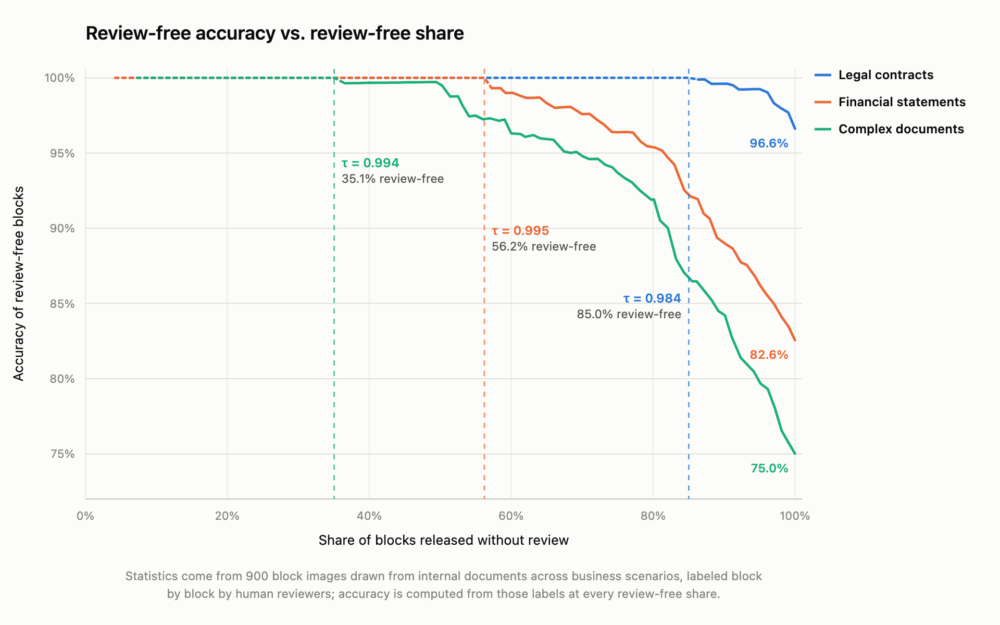
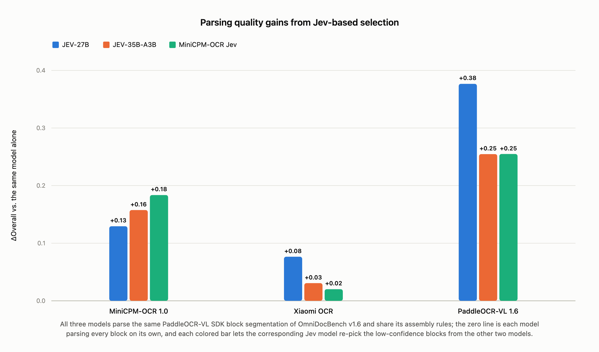
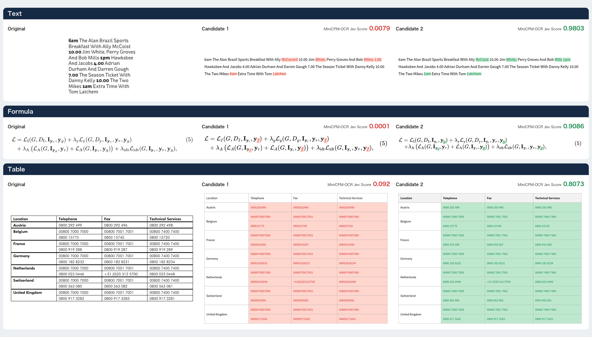

# MiniCPM-OCR Jev

[中文版](./minicpm_ocr_jev_zh.md)

[← Back to the homepage](../README.md) · [MiniCPM-OCR 1.0](./minicpm_ocr_1dot0_en.md)

MiniCPM-OCR Jev is a **2B OCR quality assessment model** for text, formula, and table regions. It assigns a score between 0 and 1 to existing OCR candidates, helping route results to human review or select the best of several candidates. This page covers the model highlights, architecture, inputs and outputs, and usage; see the [MiniCPM-OCR Jev benchmark table on the homepage](../README.md#jev-benchmark) for the full model comparison.

## Model Highlights

- 🛡️ **Strong performance in a small model**: With only 2B parameters, MiniCPM-OCR Jev achieves an AUROC (×100) of 93.6 on [JevOCRBench](https://huggingface.co/datasets/openbmb/JevOCRBench), **outperforming JEV-35B-A3B (90.1)** and approaching Qwen3.5-397B-A17B (93.8).
- 🧩 **Consistent generalization**: Across parsing results from MiniCPM-OCR 1.0, GLM-OCR, PaddleOCR-VL-1.6, and Xiaomi-OCR-0, its AUROC (×100) ranges from **91.9 to 93.4**.

## Base model and architecture

MiniCPM-OCR Jev is **trained from Qwen3.5-2B**. It retains the architecture of the vision encoder and language backbone, replacing the language model output head `lm_head` with a **binary classification head** to learn whether an OCR candidate is correct.

### Inputs and outputs

| Item | Description |
| :--- | :--- |
| Assessment unit | One text, formula, or table region and its candidate OCR result |
| Original region image | The corresponding crop from the document, preserving its visual content |
| Candidate content | OCR text and an image rendered from that text |
| Output | A quality score between 0 and 1; a higher score indicates that the model is more likely to judge the candidate correct |

Internally, the model uses a matched original region image, candidate text, and rendered image. When calling the [cloud API](https://platform.modelbest.ai/console/docs/api/ocr-jev), the Docker image, or the SDK service with a built-in renderer, provide the original region image, candidate text, and the correct region `category` (`text`, `formula`, or `table`); the service handles rendering. The SDK service without a renderer requires the caller to supply the rendered image. See the [deployment guide](./minicpm_ocr_jev_tutorial_en.md) for request fields and image encoding formats.

## Use cases

### Automatic screening to reduce human review

Score the parsed result for each region and choose a threshold using samples from your application. Results above the threshold proceed automatically; the rest go to human review. A higher threshold typically reduces the number of results that pass automatically, so monitor both the accuracy of automatically accepted results and the volume of human review.

### Selecting across models to improve parsing quality

Use the same layout segmentation to have several OCR models parse each region. MiniCPM-OCR Jev scores the candidates for the same region, selects the highest-scoring candidate, and combines the selected results in reading order. If all candidates fall below the application threshold, the region can still be sent for human review.

Candidates for the same region must use the same crop and content boundaries. MiniCPM-OCR Jev selects from existing candidates, so the final quality depends on their coverage and correctness.

## Examples

The figure below compares the original image with candidates 1 and 2, showing how MiniCPM-OCR Jev scores text, formula, and table candidates.

## Model weights

See [Model weights on the homepage](../README.md#model-weights) for the official weights. The FlagOS-adapted BF16 versions for multiple chips are listed under [Model downloads](./flagos_deploy_en.md#model-downloads).

## Inference

| Deployment method | Guide |
| :--- | :--- |
| Cloud API | [Single-candidate scoring, best-of-N for one block, and batched best-of-N](https://platform.modelbest.ai/console/docs/api/ocr-jev) |
| Docker / SDK local deployment | [Environment setup, rendering options, and service startup](./minicpm_ocr_jev_tutorial_en.md) |
| vLLM backend | [Service configuration with and without a built-in renderer](./vllm_deploy_jev_en.md) |
| FlagOS | [Torch-FL deployment guide for multiple chips](./flagos_deploy_en.md) |

When using results from the cloud API, Docker, or a service with a built-in renderer, check `verdict` before using the score. Only `scored` means model scoring completed. Fixed return values for precheck, rendering, or forward-pass failures must not be treated as low model scores.

## Parsing pipeline integration

When placing MiniCPM-OCR Jev after MiniCPM-OCR 1.0 or another parser, organize the data and results as follows:

1. Preserve the page and region identifiers, original region images, region categories, and candidate OCR text while parsing documents.
2. Submit the original image, category, and candidate text through the API or a service with a built-in renderer, which renders and scores the candidate. If rendered images are already available, use a service without a renderer.
3. Check the return status and associate valid scores with their original candidates. Apply your chosen threshold to route results to automatic acceptance or human review; for multiple models, compare candidate scores within each region.
4. Output the selected results in the original reading order and retain regions awaiting review so reviewers can refer back to the source.

Use `score` for single-candidate scoring, `score_best` to select among several candidates for one block, and `score_best_batch` for batched selection across multiple blocks. See the [API documentation](https://platform.modelbest.ai/console/docs/api/ocr-jev) for request fields, response handling, and Python examples.

## Fine-tuning

To adapt the model to specific document types or parsers, prepare original region images, candidate text, corresponding rendered images, and human correct/incorrect labels, and reserve independent validation data. The [ms-swift fine-tuning guide](./finetune_jev_en.md) covers training and inference environments, the data format, binary classification head configuration, training commands, and JevOCRBench evaluation. A [Chinese version](./finetune_jev_zh.md) is also available.

## Evaluation

[JevOCRBench](https://huggingface.co/datasets/openbmb/JevOCRBench) evaluates OCR quality assessment at the block level. Each sample contains an original region image, candidate OCR text, and a rendering of that text, with a human-annotated correct/incorrect label. The metric is **AUROC** (reported as AUROC ×100 on this page), which measures the ability to distinguish correct from incorrect candidates; higher is better.

See the [JevOCRBench results table on the homepage](../README.md#jev-benchmark) for the full comparison of Overall, Text, Formula, and Table scores.

### Validated parsers

The cross-parser experiment uses the same **200 samples** randomly drawn from JevOCRBench. Four OCR models parse the samples independently; each result is manually labelled correct or incorrect and then scored by MiniCPM-OCR Jev.

| OCR model | MiniCPM-OCR 1.0 | GLM-OCR | PaddleOCR-VL-1.6 | Xiaomi-OCR-0 |
| :--- | ---: | ---: | ---: | ---: |
| AUROC (×100) | 92.7 | 91.9 | 93.4 | 93.1 |

In this experiment, AUROC (×100) ranges from **91.9 to 93.4**, with a maximum difference of **1.5 points**. These results describe performance on the samples and parser combinations above. Validate separately on your target data when using other parsers or new document types.

> AUROC measures how well scores distinguish correct from incorrect results; it does not directly determine the accuracy of automatically accepted results. For deployment, choose a threshold using human-labelled samples from your application:
>
> 1. Collect samples that cover your actual document types and OCR errors, and label each region's candidate correct or incorrect.
> 2. Score the candidates with MiniCPM-OCR Jev and measure the **automatic acceptance rate** and **accuracy of accepted results** at several thresholds.
> 3. Choose a threshold based on the error level your application can tolerate, then verify it on independent samples. Revalidate when the parser or document distribution changes.
>
> To interpret scores as probabilities of correctness, also check whether score ranges match the observed proportion of correct results. The existing AUROC results do not establish a universal default threshold.

## License

MiniCPM-OCR Jev model weights, code, and documentation are released under the [Apache License 2.0](../LICENSE).
