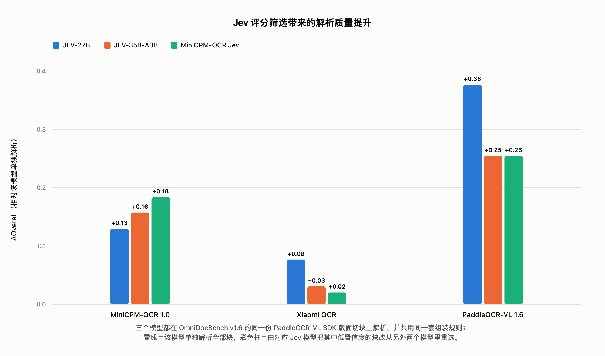

# MiniCPM-OCR Jev

[English](./minicpm_ocr_jev_en.md)

[← 返回首页](../README_zh.md) · [MiniCPM-OCR 1.0](./minicpm_ocr_1dot0_zh.md)

MiniCPM-OCR Jev 是面向文本、公式和表格区域的 **2B OCR 质量判别模型**。它对已有 OCR 候选结果给出 0–1 评分，可用于安排人工复核或从多个候选结果中择优。本页介绍模型亮点、模型结构、输入输出和具体用法；完整模型对比见 [首页 MiniCPM-OCR Jev 评测表](../README_zh.md#jev-benchmark)。

## 模型亮点

- 🛡️ **以小胜大**：仅 2B 参数，在 [JevOCRBench](https://huggingface.co/datasets/openbmb/JevOCRBench) 上决策精度 AUROC（×100）达到 93.6，**反超 JEV-35B-A3B（90.1）**，接近 Qwen3.5-397B-A17B（93.8）。
- 🧩 **稳定泛化**：在 MiniCPM-OCR 1.0、GLM-OCR、PaddleOCR-VL-1.6 和 Xiaomi-OCR-0 的解析结果上，AUROC（×100）为 **91.9–93.4**。

## 模型基座与结构

MiniCPM-OCR Jev **基于 Qwen3.5-2B 训练**，保留其视觉编码器和语言骨干的架构，将语言模型输出头 `lm_head` 替换为**二分类头**，学习判断 OCR 候选结果是否正确。

<!-- 基座与二分类任务据 finetune_jev_zh.md；视觉编码器和语言骨干架构的说明沿用原模型介绍。“保留架构”不意味着训练时冻结这些参数，训练设置以相应教程为准。 -->

### 输入与输出

| 项目 | 内容 |
| :--- | :--- |
| 判别单位 | 一个文本、公式或表格区域及其候选 OCR 结果 |
| 区域原图 | 从文档中裁切的对应区域，保留其视觉内容 |
| 候选内容 | OCR 识别文本，以及由该文本生成的渲染图 |
| 输出 | 0–1 质量评分，分数越高表示模型越倾向于判为正确 |

模型内部使用一一对应的区域原图、候选文本和渲染图。调用 [云端 API](./minicpm_ocr_jev_api_zh.md)、Docker 镜像或内置渲染器的 SDK 服务时，只需提供区域原图、候选文本和正确的区域类别 `category`（`text`、`formula` 或 `table`），渲染由服务完成；不带渲染器的 SDK 服务则需要调用方提供渲染图。请求字段与图像编码格式见对应的 [部署教程](./minicpm_ocr_jev_tutorial_zh.md)。

## 使用场景

### 自动筛选，减少人工复核

对每个区域的解析结果评分，根据业务样本选择阈值：高于阈值的结果自动进入后续流程，其他结果交由人工复核。提高阈值通常会减少自动通过的数量，需同时关注自动通过结果的准确率和人工复核量。

### 多模型择优，提升解析质量

基于同一份版面分割结果，让多个 OCR 模型分别解析各区域。MiniCPM-OCR Jev 对同一区域的候选结果评分，选择得分最高的候选，再按阅读顺序组合输出。若所有候选均低于业务阈值，该区域仍可进入人工复核流程。

同一区域的候选需要使用一致的裁片和内容范围。MiniCPM-OCR Jev 从已有候选中择优，最终质量取决于候选结果的覆盖与正确性。

## 示例

下图对照原图、候选结果 1 和候选结果 2，展示 MiniCPM-OCR Jev 对文本、公式和表格候选结果的打分。

## 评测

[JevOCRBench](https://huggingface.co/datasets/openbmb/JevOCRBench) 面向 OCR 的块级质量判别，每条样本包括区域原图、OCR 候选文本及其渲染图，真值为人工标注的正确／错误。评测使用 **AUROC**（本文按 AUROC ×100 展示），衡量模型区分正确与错误候选的能力，分数越高越好。

整体、文本、公式与表格的完整模型对比统一见 [首页 JevOCRBench 实验表格](../README_zh.md#jev-benchmark)。

### 已验证的解析器

跨 OCR 模型实验使用从 JevOCRBench 随机抽取的同一批 **200 个样本**，由四种模型分别解析，逐条人工标注正误后，再由 MiniCPM-OCR Jev 评分。

| OCR 模型 | MiniCPM-OCR 1.0 | GLM-OCR | PaddleOCR-VL-1.6 | Xiaomi-OCR-0 |
| :--- | ---: | ---: | ---: | ---: |
| AUROC（×100） | 92.7 | 91.9 | 93.4 | 93.1 |

这组实验中，AUROC（×100）为 **91.9–93.4**，最大差值为 **1.5 分**。结果反映上述样本和解析器组合上的判别表现；接入其他解析器或新的文档类型时，应使用目标数据另行验证。

## 选择复核阈值

AUROC 衡量分数对正确和错误结果的区分能力，不能直接给出自动通过后的准确率。部署时应在有人工标签的业务样本上选择阈值：

1. 收集包含实际文档类型和 OCR 错误的样本，为每个区域候选标注正误。
2. 用 MiniCPM-OCR Jev 评分，对多个阈值分别统计**自动通过比例**与**通过结果准确率**。
3. 按业务可接受的错误水平选择阈值，并在独立样本上复查效果；解析器或文档分布改变后重新验证。

若要把分数解释为正确概率，还需检查分数区间与实际正确比例是否一致。现有 AUROC 结果不足以确定通用的默认阈值。

## 模型权重

正式权重入口统一见 [首页模型权重](../README_zh.md#model-weights)；FlagOS 适配的 BF16 多芯片版本见 [下载列表](./flagos_deploy_zh.md#model-downloads)。

## 推理

| 接入方式 | 使用说明 |
| :--- | :--- |
| 云端 API | [单候选打分、单块选优与批量选优](./minicpm_ocr_jev_api_zh.md) |
| Docker / SDK 本地部署 | [环境准备、渲染方式与服务启动](./minicpm_ocr_jev_tutorial_zh.md) |
| vLLM 后端 | [不带渲染器与内置渲染器的服务配置](./vllm_deploy_jev_zh.md) |
| FlagOS | [Torch-FL 多芯片部署指南](./flagos_deploy_zh.md) |

使用云端 API、Docker 或内置渲染器服务的返回结果时，先检查 `verdict` 再使用评分；只有 `scored` 表示完成模型打分，预检失败、渲染失败或前向失败时的固定返回值不能直接当作模型低分。

## 流水线接入

接在 MiniCPM-OCR 1.0 或其他解析器后时，可按以下顺序组织数据与结果：

1. 解析文档时保留页面和区域标识、区域原图、区域类别及 OCR 候选文本。
2. 通过 API 或内置渲染器服务提交原图、类别和候选文本，由服务渲染并评分；已有渲染图时也可使用不带渲染器的服务。
3. 检查返回状态并将有效评分与原候选关联，按所选阈值分配自动通过或人工复核；多模型场景按区域比较候选分数。
4. 按原阅读顺序输出选定结果，并保留待复核区域，便于回看原文。

单候选打分使用 `score`，单块多候选选优使用 `score_best`，多块批量选优使用 `score_best_batch`。请求字段、响应读取和 Python 示例见 [API 文档](./minicpm_ocr_jev_api_zh.md)。

## 二次微调

面向特定文档类型或解析器适配时，可准备区域原图、候选文本、对应渲染图和人工正误标签，并留出独立验证数据。[ms-swift 微调教程](./finetune_jev_zh.md) 提供训练与推理环境、数据格式、二分类头配置、训练命令和 JevOCRBench 评测流程；英文说明见 [Fine-tuning](./finetune_jev_en.md)。

## 许可

MiniCPM-OCR Jev 的模型权重、代码与文档均采用 [Apache License 2.0](../LICENSE) 开源。
